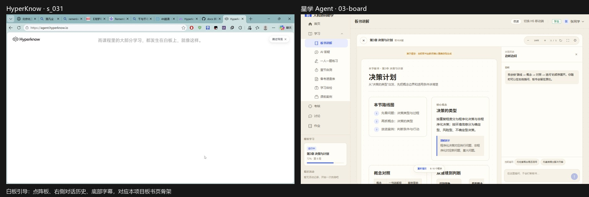
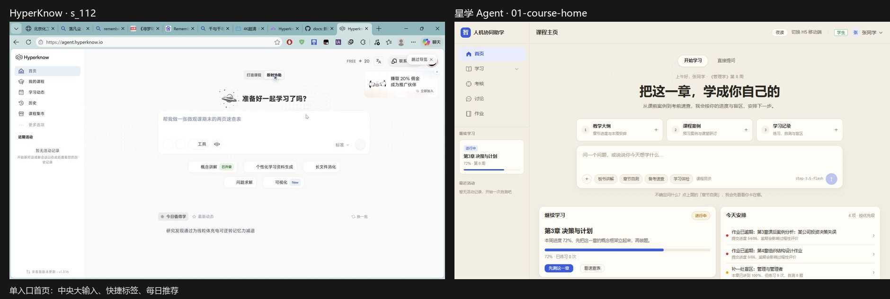
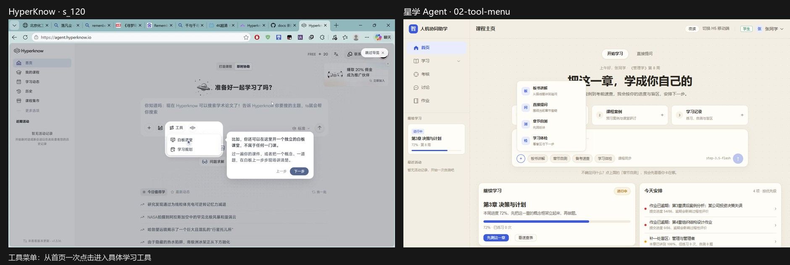
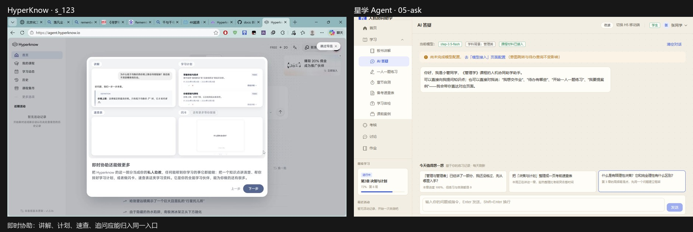
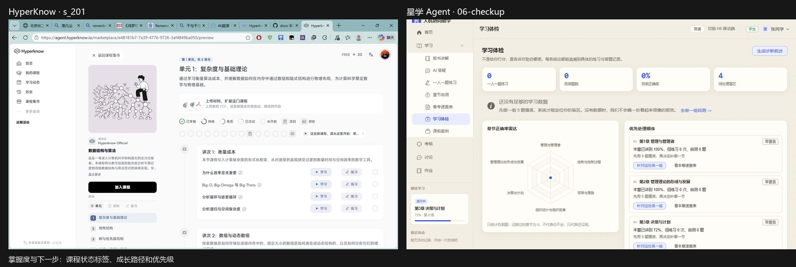
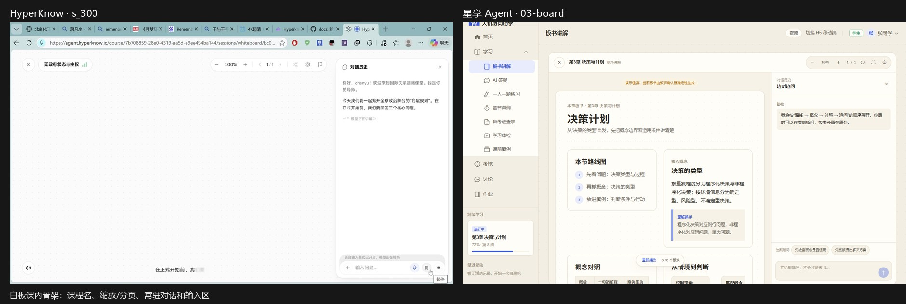
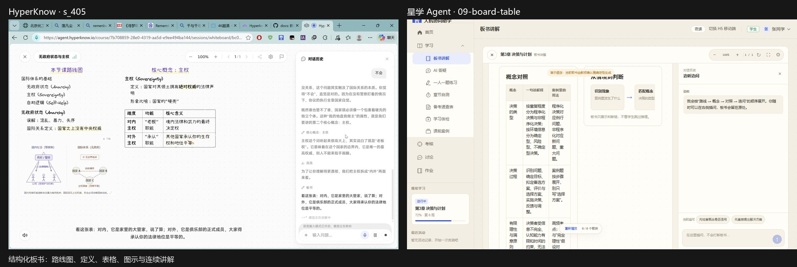
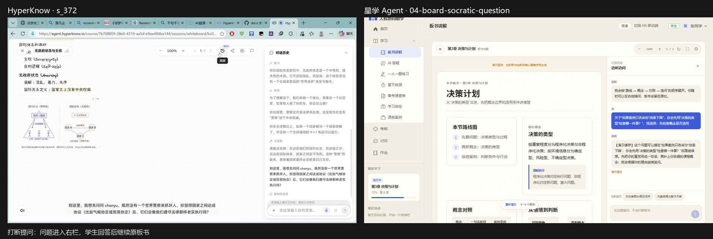

# HyperKnow 逐帧复评

> 复评日期：2026-11-04  
> 素材：`video-analysis/frames/f_001–f_113.jpg`、`video-analysis/frames1/s_001–s_453.jpg`、`video-analysis/audio.m4a`  
> 方法：先用 113 张疏采样建时间轴，再以 453 张 1fps 帧按场景细读；帧号≈秒数，`s_430` 即 07:10。  
> 证据边界：本文只把录屏画面作为产品事实；已下载的 HyperKnow 报告仅作索引，不作为证据。音频可确认讲解持续、停顿与追问节奏，但工作区没有可复现的语音转写链路，因此未把旁白转写当作事实。

---

## 1. 结论先行

HyperKnow 真正值得迁移的不是某个卡片样式，而是四段连续动线：

1. **资料先于生成**：建课/学习入口先展示大纲、课件、更多材料三个投放位，再接收学习意图。
2. **单入口再分流**：首页中央只有一个主输入；白板课、学习计划、问题求解从同一个 `+` 菜单分流。
3. **讲解是一块块长出来的**：板书从路线图开始，依次加入定义、关系图、对照表、公式和追问；不是把一段 Markdown 直接换成白底。
4. **追问不打断主线**：问题进入右侧对话历史；学生回答后，右侧反馈，板书保留并可继续生长。

本项目已经按以上四条落地核心垂直切片：`/app/board`、`/m/board`、结构化 block 渲染、逐块出现、右栏插问和 A/B 追问。带 `PDF/PPT 上传`、自由白板、语音主流程的功能没有迁移。

---

## 2. 时间轴分段

| 时间段 | 帧范围 | 页面/路由 | 场景 | 关键动作与观察 |
| --- | --- | --- | --- | --- |
| 00:00–00:07 | `s_001–s_007` | 首页上的新用户说明 | 课程结构说明 | 浮层解释“单元由 Lecture 和学习 Session 组成”；背景首页被压暗。 |
| 00:08–00:30 | `s_008–s_030` | `/` 建课首页 | 建课与首屏引导 | 三材料位、中央输入、提示词、文件卡片、工具引导依次出现。 |
| 00:31–01:37 | `s_031–s_097` | 引导白板 | 白板能力演示 | 数学公式 → 抛物线图 → 互动轨道组件 → 丝绸之路地图；板下字幕持续变化。 |
| 01:38–01:51 | `s_098–s_111` | 建课首页/连接弹层 | 资料接入 | 回到建课首页，出现连接 Canvas/学校 LMS 的弹层。 |
| 01:52–02:12 | `s_112–s_132` | `/` 即时协助 | 单入口、工具菜单、能力总览 | 中央大输入、工具浮层、四象限能力预览、欢迎弹窗。 |
| 02:13–02:34 | `s_133–s_154` | 建课与连接流程 | 设置/接入 | 搜索框、模型/版本控件、连接外部教学资源的弹层。 |
| 02:35–03:18 | `s_155–s_198` | 我的课程/动态/历史 | 列表与骨架屏 | 课程加载骨架、学习日历骨架、历史空态、课程集市入口。 |
| 03:19–04:20 | `s_199–s_260` | `/marketplace*` | 搜索与课程详情 | 预览骨架、课程详情、主导航搜索、搜索结果、加入课程确认。 |
| 04:21–04:45 | `s_261–s_285` | `/course/*/sessions/whiteboard/*` | 课程介绍与白板欢迎 | 学习卡片、欢迎白板弹窗、7 步导览、准备完成。 |
| 04:46–05:24 | `s_286–s_324` | 白板课堂 | 首次进入与排版 | 麦克风授权、右侧空对话、工具栏、设置抽屉、首句讲解和三个问题。 |
| 05:25–06:12 | `s_325–s_372` | 白板课堂 | 板书生成 | 路线图、无政府状态、示意图逐步写入，第一次苏格拉底追问出现。 |
| 06:13–06:30 | `s_373–s_390` | 白板课堂 | 第一次打断 | 学生回答“不会”，AI 肯定直觉并继续讲主权。 |
| 06:31–07:09 | `s_391–s_429` | 白板课堂 | 主权概念展开 | 设置抽屉、定义/比喻、对照表、法律平等与实力平等等结论。 |
| 07:10–07:33 | `s_430–s_453` | 白板课堂 | 第二次追问与续讲 | A/B 选择“相信承诺/跟着扩军”，反馈后自动平移至“自助原则”。 |

---

## 3. 视觉与排版采样

录屏窗口约为 `1280×758`；应用内白板内容区在浏览器工具栏下方展开。

- **白板页**：顶部约 56px 工具栏；左侧板面约 62–64%，右侧对话历史约 36–38%。
- **板面**：米白底、低对比点阵、内容不是居中大卡片，而是按阅读顺序逐步占据板面。
- **对话栏**：细边框常驻，标题和当前问题清楚；用户回答使用低饱和强调底色。
- **字体层级**：主标题约 20–24px，正文约 14–15px，行高约 1.7；小标签与时间戳约 9–11px。
- **颜色**：低饱和靛蓝用于当前项、按钮和操作；红色只用于手写圈画；大面积留白和纸色承担层级。
- **状态呈现**：模型讲解用省略号/光标，不使用夸张 loading；长任务另用骨架屏。

这些数值是画面临近值，不作为像素级复刻要求；本项目继续使用 `tokens.css` 的语义变量。

---

## 4. 逐帧观察（51 条）

每条固定记录：`帧号 / 区域 / 组件与文案 / 交互状态 / 学习意图 / 迁移落点`。

1. **`s_001` · 首页上方浮层** · 知识卡片：顶部是课程详情示意，下方写“一门课程里会有这些”，解释单元、Lecture、Session 和随堂练习。 · 状态：首次引导遮罩。 · 意图：先建立课程结构预期。 · 迁移：课程主页的“继续学习”需要先说明本课单元结构。
2. **`s_008` · 建课首页** · 三材料位“教学大纲 / 课程课件 / 更多材料”，中央输入“Hyperknow 可以为你生成课程”。 · 状态：空态、可聚焦。 · 意图：把资料接入放在生成之前。 · 迁移：`CourseHome.vue` 三材料卡保留，并让“学习记录”成为可操作上下文。
3. **`s_020` · 建课输入框** · 可见上传文件卡“机器学习实战（教材）.pdf”“我的机器学习笔记.pdf”，学习意图为“我想从零开始学机器学习，最后能自己搭模型”。 · 状态：文件已附着、提示气泡“然后发送”。 · 意图：资料 + 目标共同驱动生成。 · 迁移：未来资料库接入时，先显示引用范围，再生成。
4. **`s_031` · 白板页** · 顶部“而课程里的大部分学习，都发生在白板上，就像这样。”；中央点阵白板空白；右侧“对话历史”。 · 状态：进入白板第一帧。 · 意图：让学习者先看见学习发生的位置。 · 迁移：`Board.vue` 的三段骨架。
5. **`s_036` · 白板左侧** · 紫笔标题“二次函数”，随后出现 `y = ax² + bx + c`。 · 状态：逐块写入开始。 · 意图：先给概念名与符号。 · 迁移：`BoardCanvas.vue` 的 definition / formula 类内容按顺序出现。
6. **`s_041` · 白板左侧** · 红色手绘圈住公式，旁边写“画出来是一条抛物线。它的转折点叫顶点”。 · 状态：重点强调。 · 意图：用视觉圈画指出考试关键。 · 迁移：保留 block 内的强调样式，不让模型控制自由绘制。
7. **`s_045` · 白板 / 右栏 / 板下** · 右栏出现“我会边讲边写，讲到重点时随手做高亮和圈注……你也随时可以打断我提问”；板下字幕“你也随时可以打断我提问，不会被落下”。 · 状态：字幕逐字输出。 · 意图：明确可打断是学习规则。 · 迁移：板书右栏固定“边听边问”提示。
8. **`s_050` · 白板左侧** · 抛物线轮廓开始出现，文字和图形共用同一学习段落。 · 状态：图形渐入。 · 意图：让抽象公式获得可视化落点。 · 迁移：`diagram` block 只渲染受控结构，不做自由画布。
9. **`s_060` · 白板 / 右栏** · 完整抛物线图、对称轴和顶点标识；“y=x²：顶点与对称轴”补入右栏；用户键入“等等，为什么最低点正好在那里？”。 · 状态：示例问题插入。 · 意图：允许在讲解中即时澄清。 · 迁移：板书追问默认写入右栏，不改写板面。
10. **`s_072` · 白板右侧** · 互动组件“Orbital speed and distance”，显示距离、速度、周期三个读数。 · 状态：可交互实验嵌入。 · 意图：把概念转为可操作对象。 · 迁移：`diagram` 可展示判断链；互动控件属于后续增强，不在本轮范围。
11. **`s_080` · 白板中部** · 丝绸之路地图、商品流动方向和文字“商品在路上流动，思想也是”。 · 状态：图形 + 说明共存。 · 意图：跨学科示范白板不只画公式。 · 迁移：管理学可用流程图、组织结构图替代。
12. **`s_090` · 白板右上** · 互动组件出现刷新/重置图标；地图与轨道图同屏。 · 状态：当前实验可重试。 · 意图：让学习者通过重复实验修正理解。 · 迁移：本地 fallback 保证无模型时仍能“重新播放”板书。
13. **`s_097` · 底部操作** · “上一步 / 下一步”，点击下一步结束白板引导。 · 状态：阶段性完成。 · 意图：给用户明确的退出与前进路径。 · 迁移：板书底部“暂停/重播 + 板块进度”，避免看完后无下一步。
14. **`s_112` · 即时协助首页** · 中央“准备好一起学习了吗？”；输入框占位“帮我做一张微观课期末的两页速查表”；下方快捷 chips。 · 状态：默认空态。 · 意图：让用户先用自然语言表达目标。 · 迁移：`CourseHome.vue` 的大输入和快捷 chips。
15. **`s_120` · 中央输入框** · `+` 打开工具菜单：“白板课堂 / 学习规划 / 问题求解”；右侧气泡解释“比如……开一个独立的黑板”。 · 状态：工具菜单展开。 · 意图：从单入口分出学习形态。 · 迁移：首页“+”菜单接入 `板书讲解 / 直接提问 / 章节自测 / 学习体检`。
16. **`s_123` · 应用内四象限** · 四块能力预览：“讲解、学习计划、速查表、闪卡”。 · 状态：功能总览弹窗。 · 意图：让用户理解助手不是单一聊天框。 · 迁移：`Ask.vue` 的今日推荐与板书入口应呈现同一套学习工具语言。
17. **`s_128` · 首页上方** · “欢迎来到 Hyperknow!” 插画、主按钮“开始探索”。 · 状态：新用户欢迎弹窗。 · 意图：降低首次进入的决策成本。 · 迁移：本项目的“开始学习”页签与引导卡。
18. **`s_143` · 建课输入框** · 输入区从占位变成真实学习意图，模型/版本控件在右侧。 · 状态：文本输入中。 · 意图：把目标、模型、发送合成一个动作。 · 迁移：保留模型标识但不在主输入中抢视觉层级。
19. **`s_150` · 模态弹层** · “连接到 Canvas”，正文说明导入课程文件、启动自动取材，并让 Agent 定制讲解。 · 状态：外部系统授权入口。 · 意图：强调资料接入。 · 迁移：本项目只做本地教师确认材料，外部 LMS 明确列为后续。
20. **`s_157` · 我的课程** · 左栏完成加载，中央显示“正在加载你的课程…”与阶梯插画，右栏显示多条 skeleton。 · 状态：分栏独立加载。 · 意图：让用户知道加载发生在何处。 · 迁移：本轮板书生成已有统一 skeleton，可继续推广到课程页。
21. **`s_162` · 学习动态** · 左栏日历写“十一月 2026”，显示“今日待办 / 已完成”，右栏是大面积月历。 · 状态：骨架数据逐步出现。 · 意图：把学习计划做成可回看时间面。 · 迁移：学习计划尚未实现，后续以 7 日任务和证据跳转为核心。
22. **`s_169` · 历史** · 顶部搜索“搜索对话”，页签“对话 / 课程生成 / 深度学习课堂”，主体空态“没有符合条件的对话”。 · 状态：空态。 · 意图：学习记录可检索。 · 迁移：`trace` 已有埋点，后续补 `TraceDrawer.vue`。
23. **`s_174` · 课程集市** · 主标题“发现最适合你的课程”，精选大卡与小型课程卡并列。 · 状态：浏览态。 · 意图：把课程作为内容商品陈列。 · 迁移：不照搬集市；只借信息密度与卡片层级。
24. **`s_200` · 集市详情** · 左封面骨架、右侧标题/简介/标签/单元列表骨架。 · 状态：骨架屏。 · 意图：局部内容先占位，避免布局跳动。 · 迁移：`Board.vue` 的加载骨架。
25. **`s_201` · 课程详情** · 左侧封面、课程标题和学习者信息；正文有“第1单元，共5单元”、掌握度状态“已掌握/熟练/熟悉/已尝试/未开始”，每节右侧同时有“学习/练习”。 · 状态：加入前预览。 · 意图：把“看内容”和“立即练”绑定。 · 迁移：`CourseHome.vue` 的章节表应保持“先测/学习/掌握度”同一行逻辑。
26. **`s_223` · 集市搜索** · 遮罩层中央搜索框，查询为空时提示“更多课程即将上线”。 · 状态：全局搜索。 · 意图：减少浏览层级。 · 迁移：网站已有导航搜索的视觉记忆，但本项目优先语义入口。
27. **`s_229` · 搜索弹层** · 输入“管理”，出现课程结果卡，展示课程名、说明和入口。 · 状态：实时过滤。 · 意图：用查询直接缩小选择范围。 · 迁移：后续可将材料库搜索与章节过滤合并。
28. **`s_234` · 集市头图** · “发现最适合你的课程 / 专为你的学习方式打造”，下方筛选与精选区。 · 状态：首屏陈述。 · 意图：在内容列表前讲清价值。 · 迁移：本项目的课程主页主标题已有同类作用。
29. **`s_236` · 课程卡网格** · 多张卡片统一显示封面、课程名、简介、标签、时长/人数/评分。 · 状态：浏览态。 · 意图：用稳定卡片语法支持比较。 · 迁移：不复制课程集市，只把稳定字段用于课程首页。
30. **`s_240` · 详情加载** · 详情页左卡和右侧长内容均为 skeleton。 · 状态：异步加载。 · 意图：避免空白等待。 · 迁移：所有 AI 长任务使用同一 skeleton 语法。
31. **`s_253` · 加入课程确认** · 标题“加入这门课程？”，说明“课程将添加到你的课程列表中，你可以随时开始学习”，提供“再想想 / 加入中…”。 · 状态：二次确认、按钮忙碌。 · 意图：让加入动作可撤回且状态明确。 · 迁移：板书生成前若更改章节，需保留当前输入和返回路径。
32. **`s_259` · 已加入课程** · 顶部“遇到问题？”、左侧单元目录、中部“第1单元”、掌握度状态与进度点阵。 · 状态：加入后的学习工作区。 · 意图：从商品详情切换到学习执行。 · 迁移：本项目课程主页已经承担这一职责。
33. **`s_262` · 课程介绍卡** · 中央“本节学习内容 / 无政府状态与主权”，解释两个概念并给“开始学习”按钮。 · 状态：进入课程的过渡页。 · 意图：先说明本节为什么值得学。 · 迁移：板书页顶部 subtitle 解释本节解决什么问题。
34. **`s_265` · 白板欢迎弹窗** · “欢迎来到白板课堂”，说明 30 秒认识 7 个常用按钮，并提供“开始导览 / 我已经会了，跳过”。 · 状态：可选择跳过。 · 意图：降低首次进入工具的成本。 · 迁移：本项目不强制导览，保留工具栏 tooltip 和右侧规则。
35. **`s_267` · 导览遮罩** · 高亮顶部网络状态图标，浮层解释“服务器部署在美西地区，如连接问题点击这里”。 · 状态：热点标注第 1 步。 · 意图：把故障排查做成可发现入口。 · 迁移：板书页的设置/重播入口应有文字 title，而非只有图标。
36. **`s_280` · 白板结束导览** · 弹窗“准备好了 / 导览结束”，按钮“开始上课”。 · 状态：引导完成。 · 意图：从教学说明回到实际学习。 · 迁移：本轮 `loadLesson` 直接展示可用板书，避免多一层空转。
37. **`s_287` · 浏览器授权** · 顶部麦克风授权弹窗，板下“正在准备语音输入，请稍候”。 · 状态：浏览器权限阻塞主流程。 · 意图：语音优先。 · 迁移：明确不做语音主流程，避免误识别和授权失败阻塞。
38. **`s_300` · 白板首屏** · 顶栏课程名、- 100% +、1/1、全屏、设置；右侧“对话历史”；底部字幕“在正式开始前，我们……”。 · 状态：右侧 AI 开场白、模型正在讲解中。 · 意图：建立“板 + 聊天 + 字幕”三通道。 · 迁移：`Board.vue` 顶栏、板面、右栏和底部播放条。
39. **`s_306` · 设置抽屉** · 设置包含音色、语速 0.5–2×、板面字体“手写体/标准体”、背景网点开关。 · 状态：主动打开设置。 · 意图：让讲解适配阅读/听觉偏好。 · 迁移：板书页只保留点阵背景开关与重播，语音设置列为后续。
40. **`s_320` · 右侧对话** · AI 逐段提出三个核心问题：无政府状态是什么、为什么每个国家强调主权、无政府世界里国家能指望谁。 · 状态：先问题、后讲解。 · 意图：用问题建立后续讲解的检索框架。 · 迁移：本地 fallback 先写“本节路线图”，再给核心概念。
41. **`s_332` · 白板左侧** · 标题“本节课路线图”，列出三点：无政府状态、主权、自助逻辑；右侧对话同步解释“这三个概念是国际关系的地心引力”。 · 状态：大纲先写。 · 意图：先给整体结构。 · 迁移：`outline` block 必须是第一块。
42. **`s_359` · 白板左侧** · “无政府状态 (Anarchy)”下写误解“混乱、暴力、失序”，再写“国际关系定义：国家之上没有中央权威”；下方出现国内社会 vs 国际体系对照图。 · 状态：定义与图示逐步出现。 · 意图：用反例/类比纠正直觉。 · 迁移：`definition + diagram` 组合。
43. **`s_372` · 白板底 / 右栏** · 板书结束一段后出现“到这里，我想先问问 chenyu……如果邻国突然增加军费，你会相信和平承诺吗？”右侧标“轮到你回答”。 · 状态：等待学生输入。 · 意图：在讲解中检测理解，不先给结论。 · 迁移：`question` block + 右栏输入。
44. **`s_376` · 右侧对话** · 学生输入“不会”，消息靠近右侧显示。 · 状态：学生回答已提交。 · 意图：保留学生先验判断。 · 迁移：板书追问支持 A/B 或自由文本，不自动替学生作答。
45. **`s_385` · 右侧对话** · AI 回复“没关系，这个问题其实触及了国际关系的本质。你觉得‘不会’，直觉是对的……”并继续讲。 · 状态：流式回复。 · 意图：先承接，再反馈。 · 迁移：本地 fallback 的回答也要先承认判断，再给下一步。
46. **`s_396` · 白板中右** · 新增“核心概念：主权”，定义“国家对其领土拥有最高权威的法律声明”，比喻“国家的硬壳”。 · 状态：新概念块写入。 · 意图：让抽象概念有可记忆锚点。 · 迁移：`definition` block 允许 `analogy`。
47. **`s_405` · 白板中部** · 三列表“维度 / 功能 / 核心含义”，对“对内主权 / 对外主权”逐行比较；右侧仍保留上轮对话。 · 状态：表格写入完成。 · 意图：用结构减少概念混淆。 · 迁移：`table` block 最多 4 列、8 行。
48. **`s_423` · 白板下方** · “主权的法律平等 ≠ 实力平等”，并写“法律地位：每一国拥有一票”“实际效果：受无政府状态下的实力影响”。 · 状态：公式和结论连续出现。 · 意图：把表格结论压缩成可记判断。 · 迁移：`callout(tone=warn)` 或结论卡，而非新 Markdown 段落。
49. **`s_437` · 白板底部** · 第二次追问出现“选择相信承诺 / 跟着扩军”两枚 A/B 按钮，并有“点击一个选项，或直接输入你的答案/提问”。 · 状态：选择型追问。 · 意图：降低表达门槛，同时保留开放输入。 · 迁移：`question.options` + 右栏自由文本双通道。
50. **`s_442` · 右侧对话** · 学生选择“选择相信承诺”，按钮显示选中态。 · 状态：选项已选。 · 意图：记录学生判断而不是只显示答案。 · 迁移：question block 的选项点击后进入右栏对话。
51. **`s_453` · 白板全画布** · 原来左、中内容向左移出，右侧出现“自助原则 (Self-Help)”，板面没有换页但发生平滑平移；顶部仍显示页码 1/1。 · 状态：板面继续生长/平移。 · 意图：让讲解连续，不把每块都做成独立问答页。 · 迁移：本轮采用可滚动 board-stage；后续可增加“跟随当前 block”自动滚动。

---

## 5. 交互状态清单（16 条）

| # | 状态 | 帧证据 | 设计含义 |
| --- | --- | --- | --- |
| 1 | 新用户压暗浮层 | `s_001` | 先解释课程结构，避免把首屏当普通搜索框。 |
| 2 | 工具菜单展开 | `s_120` | 单入口必须有可发现的分流，否则用户不知道能做什么。 |
| 3 | 文件附着态 | `s_020` | 资料先于生成，输入框同时承载意图和材料。 |
| 4 | 搜索/命令弹层 | `s_223`、`s_229` | 全局搜索是课程集市的备选路径，不是本项目主路径。 |
| 5 | 课程详情 skeleton | `s_200`、`s_240` | 异步内容要保留结构尺寸，避免页面跳动。 |
| 6 | 课程加载态 | `s_157` | 分栏分别 loading，使已有内容不被整页阻塞。 |
| 7 | 加入课程二次确认 | `s_253` | 有副作用的入口先确认，按钮同时反馈处理中。 |
| 8 | 白板欢迎弹窗 | `s_265` | 工具复杂时先给可跳过的导览。 |
| 9 | 热点导览 | `s_267` | 通过局部遮罩解释工具栏，不把帮助写成独立文档。 |
| 10 | 麦克风授权 | `s_287` | 语音是强依赖；本项目明确不以语音作为主流程。 |
| 11 | 模型讲解中 | `s_300`、`s_382` | 状态文字放在内容流中，弱化全局 loading。 |
| 12 | 逐字字幕 | `s_045`、`s_300` | 字幕随讲解推进，帮助用户跟上逻辑。 |
| 13 | 追问等待 | `s_372` | 右侧显示“轮到你回答”，不自动跳答案。 |
| 14 | 学生回答 | `s_376`、`s_442` | 回答进入对话历史，板面保持原位置。 |
| 15 | 反馈并续讲 | `s_385`、`s_445` | 先承接学生判断，再回到主线讲解。 |
| 16 | 自动平移/继续生长 | `s_453` | 内容增长时保持连续心智模型，不强制分页。 |

---

## 6. 8 组并排对比

说明：左侧是 HyperKnow 录屏帧，右侧是本项目本地构建的真实浏览器截图；图片由 `docs/research/tools/build-comparison-sheets.py` 可重复生成。

### 6.1 白板引导骨架

结论：HyperKnow 的点阵板、右栏对话历史和板下字幕已被 `Board.vue` 承接；本项目把“讲到哪里”改成了可暂停、可重播的结构化板块。

### 6.2 单入口首页

结论：两者都使用中央主输入；本项目保留纸感和材料卡，更强的差异化是课程进度、今日安排和教师确认材料。

### 6.3 工具菜单

结论：本项目已补齐从首页一次点击到具体工具的入口；菜单顺序优先服务于教学闭环，而不是课程集市。

### 6.4 即时协助能力

结论：HyperKnow 用四象限解释能力；本项目用现有 Ask 页的推荐问题和统一入口承接，后续可在首次进入时加一次轻量能力提示。

### 6.5 掌握度与下一步

结论：HyperKnow 的课程详情把掌握标签与练习按钮放在同一行；本项目在 `Checkup.vue` 把盲区证据和可执行下一步放在同一屏，符合“知道下一步做什么”的定位。

### 6.6 白板完整骨架

结论：本项目已经具备课程名、缩放/页数、全屏、对话栏和输入区；尚未做语音主流程与自动平移，这是主动取舍。

### 6.7 结构化板书

结论：两者都把“定义 + 图示 + 对照表”放在同一学习段落；本项目用固定 block schema 替代自由画布，更适合课程质量控制和离线演示。

### 6.8 苏格拉底追问

结论：本项目已经实现“右栏提问、不打断板书、回答后继续追问”；回答目前走本地确定性兜底，真实模型需负责人配置有效密钥后验收。

---

## 7. 形态对照表

| HyperKnow 构件 | 我们的现状 | 差距 | 改哪个文件 | 工作量 |
| --- | --- | --- | --- | --- |
| 中央大输入 + `+` 工具菜单 | 首页已有大输入和工具 chips；本轮补齐 `+` 菜单 | 菜单入口仍不如 HyperKnow 的“第一眼可发现”明显 | `views/web/CourseHome.vue` | 已完成 |
| 白板 + 右栏对话历史 | 本轮新增 `/app/board` 与 `/m/board` | 语音条、自动平移、板内记笔记未做 | `views/web/Board.vue`、`views/mobile/MBoard.vue`、`components/BoardCanvas.vue` | 已完成核心，后续增强 |
| 板书 `路线图 → 定义 → 图示 → 表格 → 追问` | 本轮 block schema 已落地 | 模型真实输出尚未验收；当前演示走教师确认稿兜底 | `utils/board.js`、`api/board.js`、`api/prompts/board.js` | 已完成核心 |
| 白板工具栏：缩放、页码、全屏、设置、笔记 | 缩放、页码、全屏、重播、点阵开关已实现 | 笔记与自动平移未做 | `views/web/Board.vue` | 部分完成 |
| 骨架屏 | 板书页已有统一 skeleton | 课程列表、集市等旧页面仍是散落 loading | `Board.vue` 可抽成通用组件 | 0.5 人日 |
| 每日推荐 | 首页已有 Feed、Ask 页已有每日问题 | 缺“换一批”和一次点击直接开始板书 | `utils/feed.js`、`CourseHome.vue`、`Ask.vue` | 0.5 人日 |
| 学习计划/日历 | `studyPlan=false`，未实现 | 无 7 日计划、无计划到练习的证据闭环 | 新增 `stores/plan.js`、`views/web/Plan.vue` | 2–3 人日 |

---

## 8. 动线对照表

| HyperKnow 步骤 | 我们对应步骤 | 步数差 | 阻塞点 |
| --- | --- | --- | --- |
| 首页 → `+` → 白板课堂（2 步） | 首页 → `+` → 板书讲解（2 步） | 0 | 已补齐 |
| 白板内直接发问（0 步切页） | 右侧输入条直接发问（0 步切页） | 0 | 已补齐 |
| 学生选择 A/B 后继续讲解（1 步） | question block A/B 或右栏自由文本（1 步） | 0 | 已补齐 |
| 首页推荐 → 开始学习（1 步） | 今日安排 → 对应练习/体检（1 步） | 0 | 已有 |
| 课程详情 → 学习与练习并列（1 步） | 课程主页 → 章节行“去自测” | 0 | 已基本对齐 |
| 白板内容增长 → 自动平移（0 步） | 板书页内部滚动或重播（1 步） | +1 | 后续可做跟随 block |
| 课程集市 → 搜索 → 详情 → 加入 | 不采用课程集市；直接课程主页/章节学习 | 不适用 | 明确不做 |

---

## 9. 取舍结论表

| 构件 | 采纳/改造/不做 | 理由 |
| --- | --- | --- |
| 结构化板书 | 采纳并改造 | 教学价值最高；block schema 可控来源、可离线、可审计，优于自由画布。 |
| 白板内追问 | 采纳并改造 | 符合“边讲边校验理解”；问题进入右栏，避免打断主线。 |
| 单入口 + 工具菜单 | 采纳并改造 | 这是 HyperKnow 最强的形态参照；本项目只保留学习工具，不承载课程集市。 |
| 先测后讲 | 保留现有 | 项目已有自测与澄清；本轮不做大规模重构。 |
| 学习计划 | 采纳但延后 | 与现有 Feed、Persona 有高复用价值；本轮先完成板书闭环，计划留作下一垂直切片。 |
| 页码级引用 | 采纳但延后 | 差异化价值高；必须先有 `chunkId` 回填，禁止模型自写页码。 |
| 课程集市 | 不做 | 课程内容生产成本高，且与“嵌入一门真实课程”的定位冲突。 |
| 一键生成整门课 | 不做 | 容易削弱教师治理和教材依据，不符合本项目定位。 |
| 积分、邀请返佣、订阅墙 | 不做 | 与学习闭环无关，也会引入不应有的品牌/商业层。 |
| 语音主流程 | 暂不做 | 授权、识别和噪声风险高；未来可在 H5 做可选输入。 |
| 自由白板 | 不做 | 无法稳定验收、容易跑偏；优先结构化 block。 |
| 多 Agent 组织 | 不做 | 当前价值不及教学闭环，增加复杂度和演示风险。 |
| 教师治理端 | 保留并强化 | 圈人出题、复核、审计是 HyperKnow 没有的差异化能力。 |
| 教材依据/章级来源 | 保留并强化 | 作为本项目与通用学习助手的核心差异；后续升级到 `chunkId` 引用。 |

---

## 10. 已落地与后续项

本轮已经落地：

- `views/web/Board.vue`：桌面白板页、课程信息、工具栏、右栏对话、逐块出现与重播。
- `views/mobile/MBoard.vue`：H5 简化版板书页与侧栏式讨论入口。
- `components/BoardCanvas.vue`：`outline / definition / table / diagram / callout / question` 六类 block 的受控渲染。
- `api/board.js`、`api/prompts/board.js`、`utils/board.js`：模型 JSON 约定、解析、教师确认稿兜底和演示缓存标识。
- `CourseHome.vue` 的 `+` 工具菜单、双端路由、`WEB_TO_MOBILE`、`GROUP_OF` 与 H5 导航入口。
- `frontend/tests/e2e/critical-flows.spec.js`：10 条关键链路回归，覆盖双端板书和生产深链接。

后续按依赖顺序：

1. 用真实模型配置跑板书生成、插问、自测、速查、诊断，并填 `docs/release/EVIDENCE-TEMPLATE.md`。
2. 补自动跟随当前 block 的平移/滚动、笔记导出和真实模型流式呈现。
3. 实现学习计划，把 Feed 的“为什么推荐”与计划任务复用。
4. 把材料检索结果升级到 `chunkId → 页码` 的前端回填，禁止模型输出页码。

## 11. 验收状态（本轮）

| 项目 | 结果 |
| --- | --- |
| 逐帧观察 ≥40 条 | 51 条 |
| 交互状态 ≥15 条 | 16 条 |
| 并排对比 ≥8 张 | 8 张 |
| 板书核心垂直切片 | 已实现，构建通过 |
| Edge/Playwright 页面加载 | 已通过，课程主页、板书、答疑、体检、自测、速查均可截图 |
| 板书追问 | 已通过，答问写入右栏并标“演示缓存” |
| 控制台错误 | 板书页本轮截图未发现 error |
| 真实模型链路 | 阻塞：需负责人轮换并配置有效 key |
