# 人机协同助学智能体 · 使用说明与特色优势

> 项目：面向经管课程全教学周期的人机协同助学智能体
> 课程载体：《管理学》（北京化工大学经济管理学院 · 2026 秋季学期 · 3 学分 / 48 学时 / 86 名学生）
> 版本：v1.0 ｜ 日期：2026-10-30
> 访问地址：https://zhuxue-agent.app.workbuddy.host/?sharecode=Z7X276B67K

---

## 一、产品是什么

一款嵌入《管理学》课程全教学周期的 AI 助学智能体，覆盖**课前案例征集 → 课堂一人一题练习 → 过程性评价沉淀 → 个性化模拟面试考核 → 评分反馈**的完整闭环。

它不是"一个聊天窗口"，而是四类角色（学生 / 助教 / 教师 / 管理员）各自拥有完整动线的教学协同工具：学生获得"人人有题练、题题有反馈"的个性化训练，教师获得"圈人出题、一键复核、学情可视"的治理能力，AI 在各个环节承担教练与助教角色——引导思考，而不直接给答案。

## 二、快速开始

### 1. 演示账号（密码均为 `123456`）

| 账号 | 姓名 | 角色 | 用途 |
| --- | --- | --- | --- |
| `student` | 张同学 | 学生（管理类） | 学生动线主演示 |
| `student2` | 李骁 | 学生（工科类） | 演示学科背景差异化出题 |
| `ta` | 李助教 | 助教 | 协助视角（主控台只读） |
| `teacher` | 王教授 | 教师 | 教师治理动线主演示 |
| `admin` | 系统管理员 | 超级管理员 | 全部功能 + 模型接入 |

登录页提供角色标签**一键快捷填入**，登录时可选择进入 **Web 端（桌面）** 或 **H5 端（手机）**。

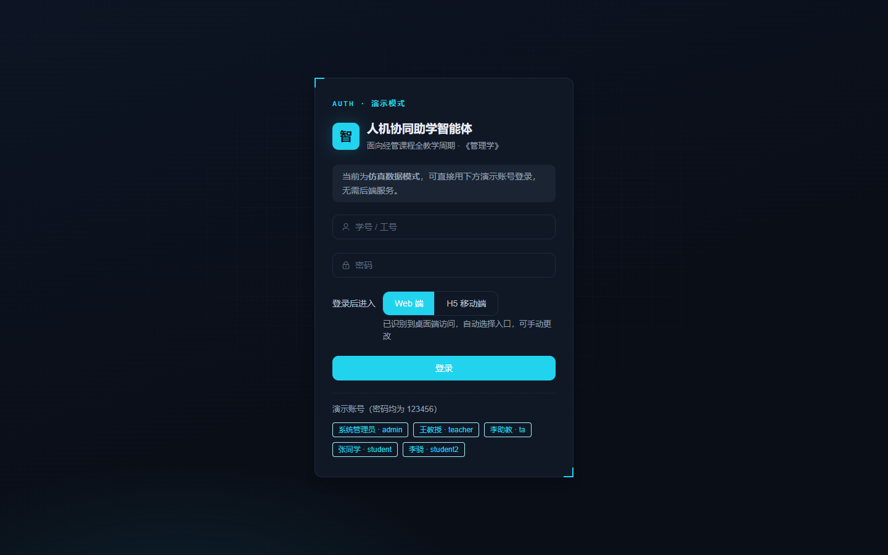

### 2. 三种使用方式

| 方式 | 操作 |
| --- | --- |
| 公网链接（推荐） | 浏览器打开上方链接，首先进入**产品落地页**，点「进入在线演示」用演示账号登录即可 |
| 本地运行 | `cd frontend && npm install`，然后 `npm run dev`（开发，默认 5173 端口）或 `npm start`（构建 + 生产预览） |
| 手机预览 | 手机与电脑连同一 WiFi，访问 `http://<电脑IP>:5173/m/course`；H5 端布局按 480px 手机宽度设计，桌面浏览器打开会自动居中模拟手机 |

> **路径说明**：产品落地页位于 `/`；登录后应用主体位于 `/app/...`（如课程主页 `/app/course`），H5 端位于 `/m/...`。旧路径（`/course`、`/ask` 等）会自动跳转到对应 `/app` 新路径并保留参数，旧链接不失效。

### 3. 产品落地页（`/`，无需登录）

落地页按"一个主张、一类受众、一个主动作"组织，面向首次访问的评委与老师：

- **Hero**：主张"大班课上，人人有题练，题题有反馈"，附课程主页实拍截图与 AI 三维反馈浮动卡；
- **痛点与解法**：教师访谈的五个老问题（练习机会、预习抓手、考核脱节、学生差异、功能寻路）逐一对应智能体五个模块；
- **运行实况**：86 名学生、48 学时真实运行数据；
- **常见问题**：8 项 FAQ（用在哪门课、是否直接给答案、接入什么模型、数据存在哪等）；
- 支持纸感 / 夜读双皮肤切换，已登录用户点 CTA 直接回到课程页。

### 4. 界面皮肤切换（三处入口）

- **H5 端**：底部导航栏右侧胶囊按钮
- **Web 端**：顶栏右侧切换按钮
- **H5「我的 → 外观」**：皮肤选择弹层

两套皮肤（**纸感**默认 / **夜读**阅读模式）切换后刷新仍保持，课程主页、一人一题、考核三个页面会整块切换装帧结构（详见第五节）。两套皮肤均为浅色纸面：纸感是卡其底 + 米白卡 + 靛蓝强调的点阵工作台，夜读是象牙纸 + 衬线标题 + 朱砂批注的阅读版式。

## 三、学生端使用说明

### 1. 课程主页（`/course` 或 `/m/course`）

进入即看到以学习为中心的首屏：顶部「开始学习 / 直接提问」两个胶囊页签、居中主张「把这一章，学成你自己的」、三张材料卡（教学大纲 / 课程案例 / 学习记录）、带模型名的大输入框与快捷 chips（章节自测 / 备考速查 / 学习体检）。下方是「继续学习」进度卡、按优先级排序的「今天安排」、四个主入口与一行次级链接（案例 / 考核 / 答疑 / 论坛）。输入问题后回车即跳到答疑页并自动发送。

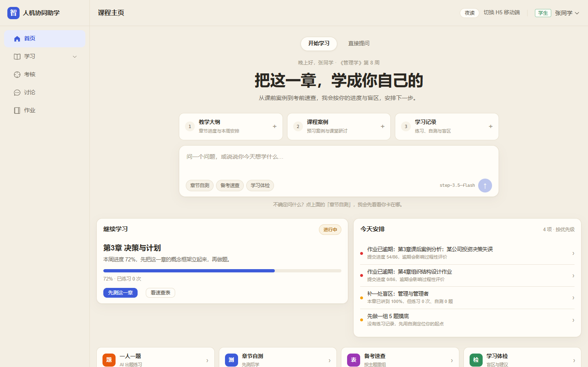

同一页面切换到**夜读**皮肤后，整块切换为"学习学报"杂志封面装帧——衬线巨型标题、斜体朱砂强调词、三栏目录（TODO 今日待办 / CASE 本节课案例 / PROGRESS 我的进度）：

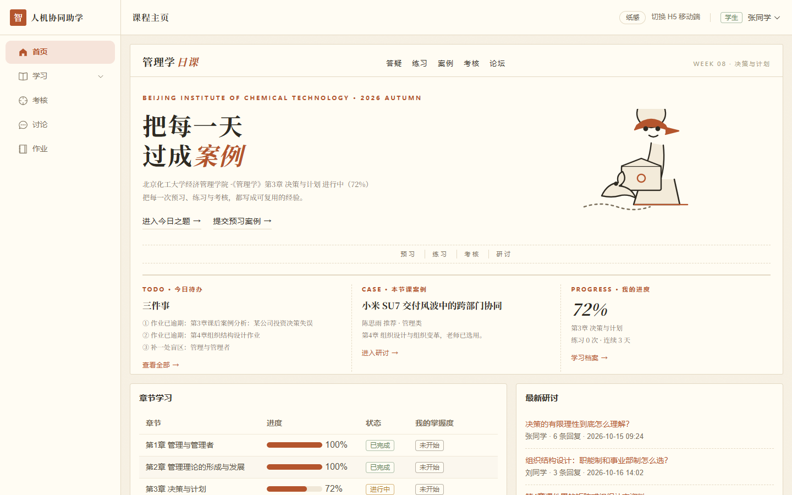

### 2. AI 答疑（`/ask` 或 `/m/ask`）

像微信一样对话即可。两个实用技巧：

- **对话式跳转**：直接说"我想交作业""我要练习""看考核"等，系统优先命中本地意图引擎，返回**可点击的跳转卡片**直达对应页面，不必层层点菜单；
- **真实大模型问答**：课程问题（如"泰勒科学管理的要点"）由已接入的大模型回答，自动携带最近 20 条对话上下文，支持多轮追问（"它"指代可正确解析）。

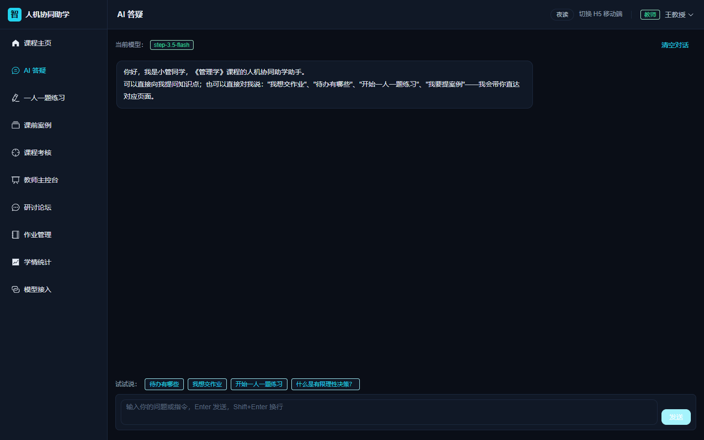

### 3. 一人一题练习（`/practice` 或 `/m/practice`）

四步完成一次训练：

1. 选择**考查章节**与**题型**（案例分析 / 情景模拟 / 即兴演讲）；
2. 点「生成题目」——AI 按你的学科背景取材生成专属情境题（管理类用企业管理场景，工科类用工程管理 / 生产运营场景）；
3. 作答并提交；
4. 获得 **AI 三维反馈**（观点结构 / 理论运用 / 表达逻辑），先肯定亮点再给一条可操作的改进建议。

练习记录自动计入**过程性评价**，将成为后续考核出题的依据。

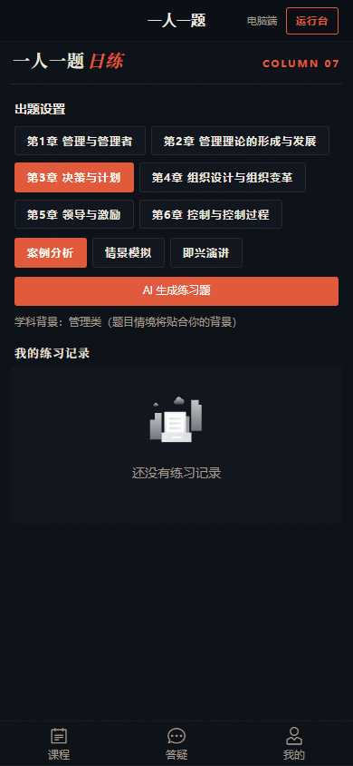

夜读皮肤下，练习题装帧为报纸专栏（`COLUMN 07 · 一人一题`），AI 反馈装帧为朱砂"红批"；Web 端同一流程如下：

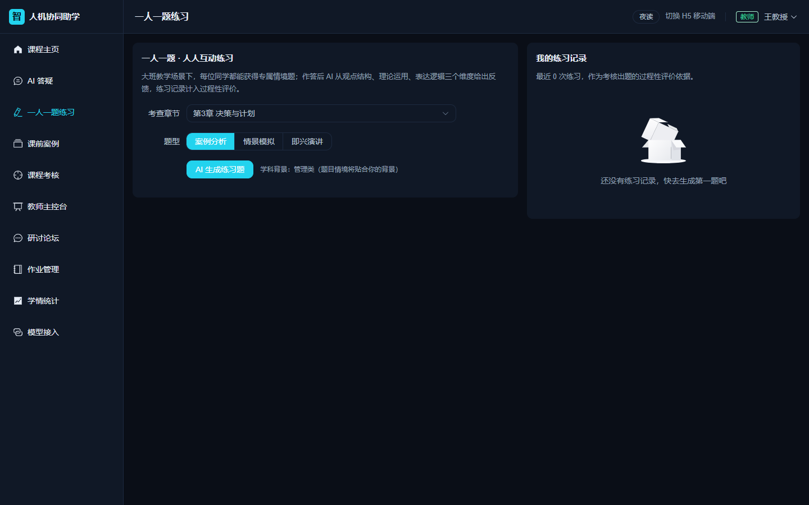

### 4. 课前案例征集（`/cases` 或 `/m/case`）

预习中发现的感兴趣案例可提交：填写标题、章节、内容后，AI 辅助整理出**一句话摘要 + 知识标签**。被教师选用的案例会在课程主页置顶展示，成为课堂研讨素材。

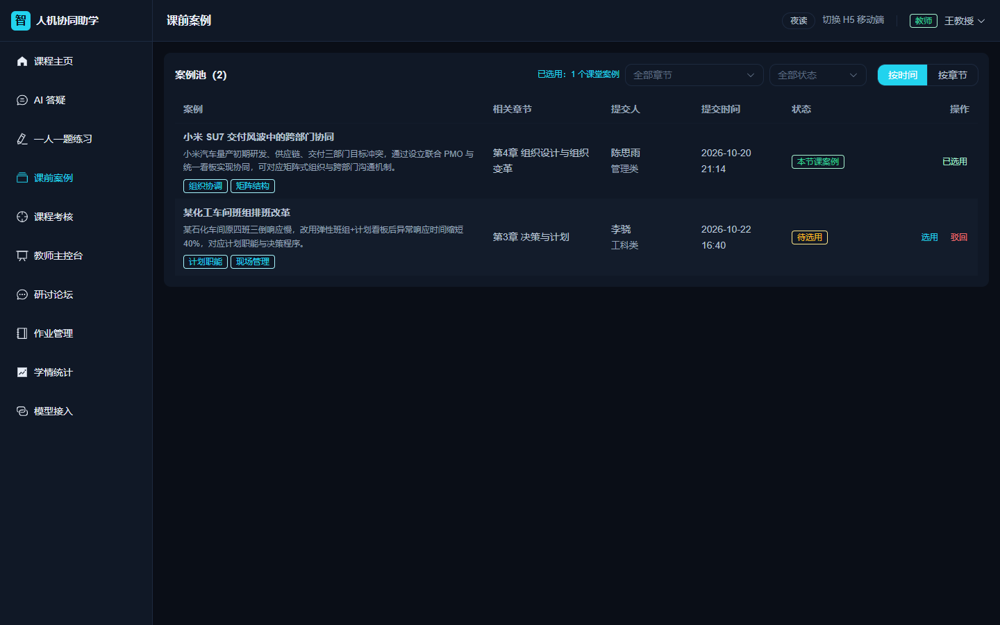

### 5. 课程考核（`/assessment` 或 `/m/assessment`）

教师发布后，学生在此看到为自己定制的**模拟面试题**（结合个人练习记录生成）。作答后获得 AI 反馈，教师评分后以得分印章呈现。夜读皮肤下，题目、作答、反馈分别装帧为「面试函」「回信」「红批」：

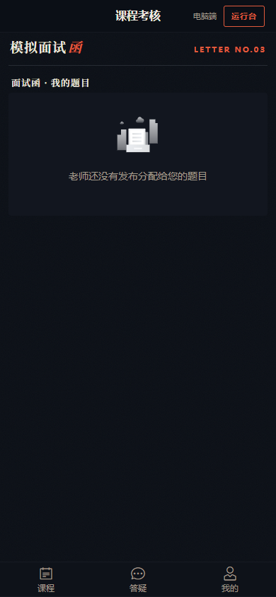

### 6. 章节自测（`/selftest` 或 `/m/selftest`）

「先测后学」的入口：选章节与题量（5/10/20）→ 合上资料作答 → 提交后才显示解析。系统自动判分，并把反复出错的概念整理成"概念盲点"，直接接到学习体检与针对练习。自测模式不提供任何提示——回想时的吃力，是记忆在加固的位置。

### 7. 备考速查表（`/cheatsheet` 或 `/m/cheatsheet`）

按**主题**而不是章节顺序重组知识点，每条标出来源章节。生成前先问两个选择题（用途、担心题型），支持屏幕阅读版与 A4 打印压缩版；打印样式强制白底黑字、双栏、两页内。

### 8. 学习体检（`/checkup` 或 `/m/checkup`）

用雷达图与清单回答"我到底哪里不会"：区分**零覆盖**（本章开讲但从未练习）、**低表现**（自测正确率低于 60%）、**概念盲点**（同一概念反复答错），按考核风险排序，每条带具体数据证据，并可一键生成针对练习。

### 9. 个人设置（H5「我的」）

查看账号信息、设置**学科背景**（影响 AI 出题与讲解取材）、切换界面皮肤、退出登录。学习工具区已加入自测、速查表、学习体检三个入口。

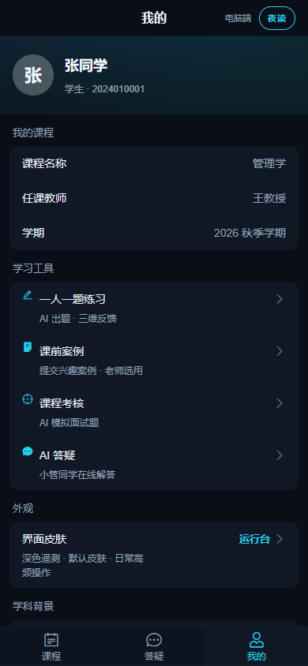

## 四、教师端使用说明

### 1. 教师主控台（`/console`）

一屏总览：课程统计卡片、进行中的作业跟踪、需要关注的学生预警（助教为只读视角）。

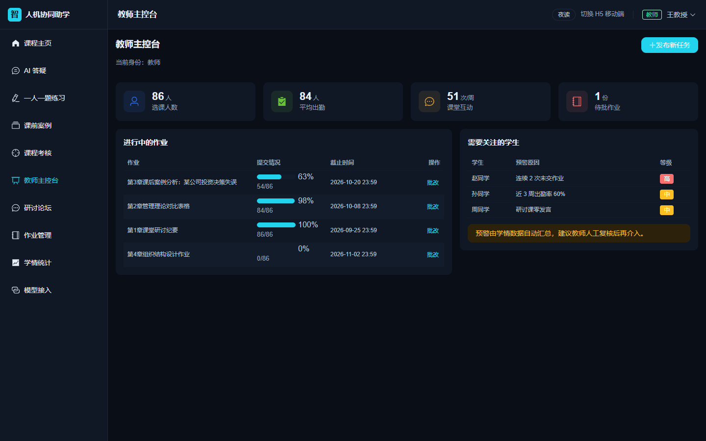

### 2. 案例池管理（`/cases`）

对学生提交的案例按章节筛选 / 排序，查看 AI 整理的摘要与标签，**选用**（主页置顶展示）或**驳回**。

### 3. AI 智能出题考核（`/assessment`）——核心流程

1. **圈人选范围**：勾选目标学生，划定章节 / 题型 / 难度；
2. **AI 逐人生题**：结合每位学生的过程性评价（练习记录）生成个性化模拟面试题，评价薄弱的章节自动加大考查权重；每题附「参考要点」供复核，学生端不可见；
3. **教师复核**：逐题编辑、驳回或批量通过后发布；
4. **学生作答**：学生端收到面试题并提交作答，AI 生成反馈；
5. **教师评分**：打分后计入成绩。

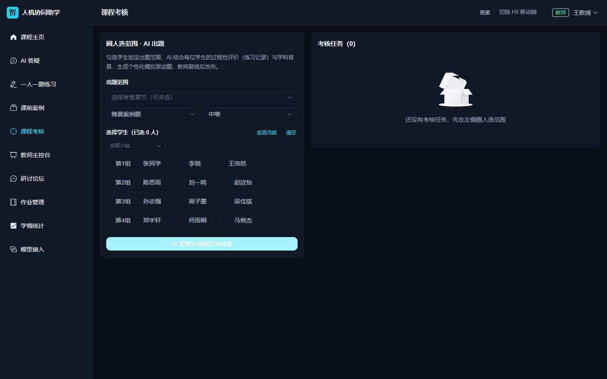

### 4. 学情统计（`/statistics`）

ECharts 三图联看：学习趋势折线图、章节掌握度雷达图、学生分层饼图，辅助定位薄弱章节与关注对象。

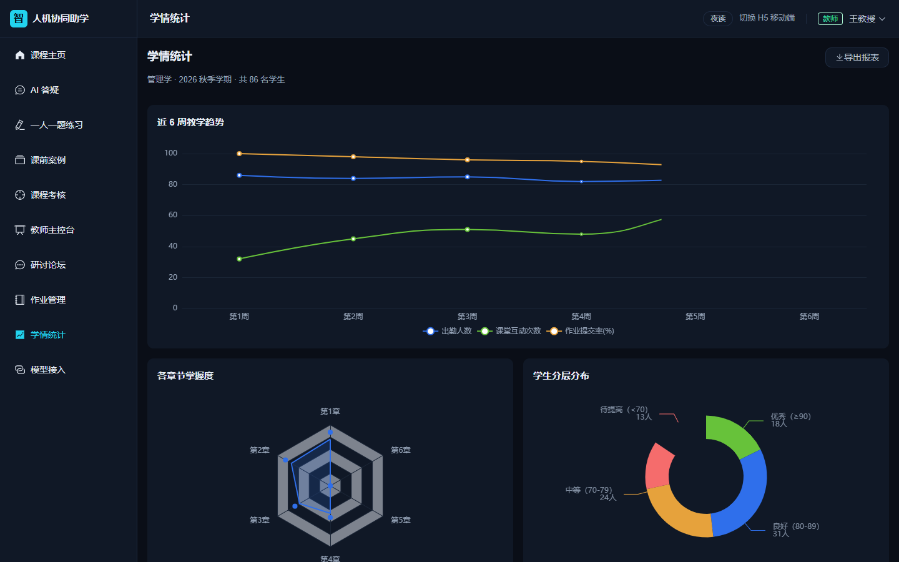

### 5. 模型接入（`/model`，admin / teacher 可见）

配置大模型服务：服务商、接口地址、模型（内置阶跃星辰 step-3.5-flash / step-3.7-flash / step-router-v1 / step-5-preview 候选，也可手输任何 OpenAI 兼容模型）、API 密钥、温度、助教人设（System Prompt）。「测试连接」可一键验证当前配置；配置保存在本地，刷新不丢失，「恢复默认」一键还原。

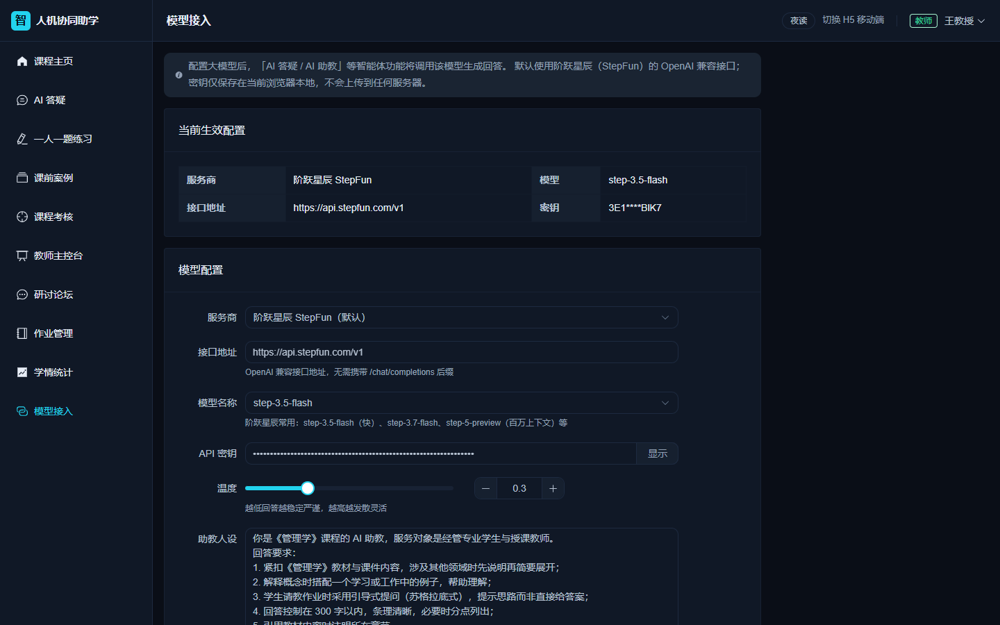

### 6. 研讨论坛与作业管理（`/forum`、`/homework`）

论坛支持搜索、按章节筛选、置顶排序；作业管理支持状态筛选与截止倒计时，学生 / 教师双视角切换。

### 7. 课程资料库（`/materials`，admin / teacher / ta）

AI 的"教材依据"从这里来。教师按章节粘贴课件或教材正文，材料标记为"教师确认"后才进入 AI 上下文；每次提问按章节与关键词检索 top-3 片段注入，并在回答中标注来源。页面内置"检索自检"，可输入一个学生会问的问题，查看系统实际会取哪几段材料。当前预置六章课程纲要（教师确认稿），正式使用时替换为真实课件即可。

## 五、特色与优势

### 1. 教学闭环特色：AI 嵌入全周期，且始终"教"而不是"替"

五个模块对应教师访谈的五大痛点，环环相扣：

| 模块 | 解决什么 | 亮点 |
| --- | --- | --- |
| 课前案例征集（M3） | 学生预习无抓手 | 学生提交 + AI 整理摘要标签，教师选用后课堂置顶 |
| 一人一题练习（M2） | 大班只有个别组上台练 | 章节 × 题型自选，AI 出题贴合学科背景，三维反馈 |
| 个性化考核（M4） | 纯考试与实际运用脱节 | 圈人出题 → AI 结合过程性评价逐人生题 → 复核发布 → 面试式作答 |
| 学科背景差异化（M5） | 经管类与工科类同班差异 | 学生自设背景，出题与讲解自动切换取材方向 |
| 对话式意图跳转（M1） | "说人话找不到功能" | 本地规则引擎秒回跳转卡片，未命中才转大模型 |

所有 AI 反馈遵循同一教学原则：**先肯定亮点，再给一条具体可操作的改进建议，不代替学生思考，不给标准答案**。

### 2. 个性化特色：两个差异化引擎

- **学科背景引擎**：同一章节，管理类学生拿到企业管理情境题，工科类学生拿到工程管理 / 生产运营情境题；
- **过程性评价引擎**：M2 的每次练习自动沉淀为评价数据，M4 出题时薄弱章节加大权重——**练过的题，决定考你的题**。

### 3. 产品设计特色：浅色纸感 + 双端 + 仪式感

- **双皮肤体系**：默认「纸感」浅卡其纸面（卡其底 + 米白卡 + 靛蓝强调 + 点阵纹理 + 轻阴影），接近 HyperKnow 的学习工作台气质；「夜读」浅象牙纸（衬线标题 + 朱砂批注 + 近直角 + 面试函印章），用于阅读与展示场景。基于 60+ 设计令牌，结构性差异整块切换，切换不影响任何交互逻辑；两套皮肤均为浅色，不再提供深色版本；
- **仪式感装帧**：练习是「今日专栏」（COLUMN 07）、反馈是「红批」、考核是「面试函」、得分是「朱砂印章」——用编辑排版语法消解在线考试的紧张感；
- **双端一套架构**：Web（Element Plus）与 H5（Vant）复用同一套 Store 与路由，角色权限由路由守卫统一控制，学生访问教师页自动拦至 403；
- **角色感知首页**：学生看到「把这一章，学成你自己的」+ 材料卡 + 大输入框 + 继续学习 + 今天安排；教师看到「把这一周的教学，安排明白」+ 课程资料 / 待选案例 / 待复核题。

H5 端两套皮肤对比：

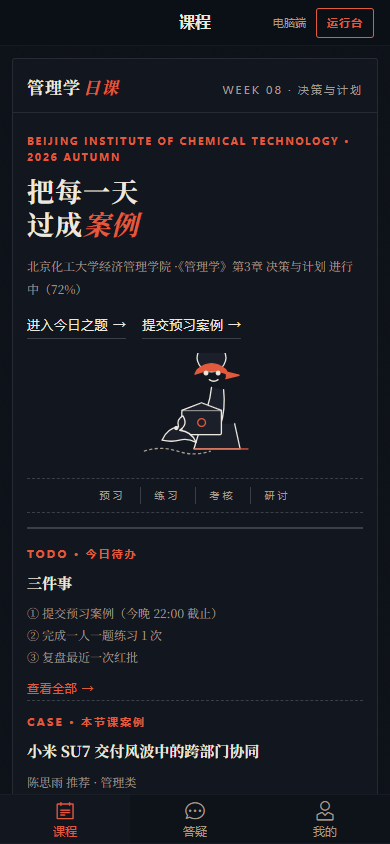

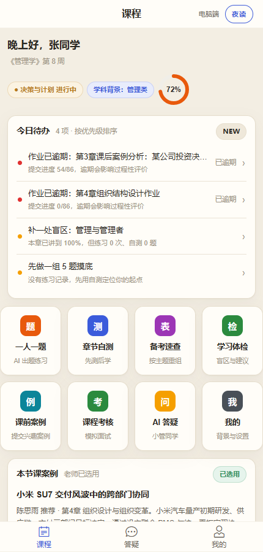

### 4. 工程技术特色

- **模型接入可配置**：基于 OpenAI 兼容协议，页面上即可切换任意服务商与模型，密钥本地保存、支持一键测试连接；错误提示全中文化（401 / 404 / 429 / 超时 / 跨域分因提示）；
- **无后端可完整演示**：仿真数据 + localStorage 持久化，开箱即演；`/api` 代理、`useMock` 开关、统一响应拦截器均已预留，后端就绪后逐页替换即可，页面不动；
- **离线演示支持**：`file://` 协议双击 `dist/index.html` 自动降级 hash 路由，无网环境可路演；
- **工程质量验证**：生产构建通过；39 项 Playwright E2E 断言全部通过，其中 13 项走**真实大模型链路**（出题 → 作答 → 红批反馈全流程），并有多设备截图逐项比对。

## 六、建议演示路径（约 8 分钟路演动线）

1. **登录**（`student`）→ 课程主页：纸感首屏（两个页签 + 三张材料卡 + 大输入框 + 继续学习 + 今天安排），演示输入一个问题后回车直达答疑并自动发送；点顶栏切换按钮 → 夜读杂志封面，讲"课程即刊物"；
2. **AI 答疑**：输入"我想交作业"——展示意图跳转卡片；再问一个课程问题——展示真实大模型回答；
3. **一人一题**：选章节 / 题型 → 出题 → 作答 → 红批三维反馈（夜读装帧）；
4. **切换 `teacher` 登录** → 主控台总览 → 案例池选用一个案例；
5. **考核全流程**：圈 2 名学生 → AI 出题（讲过程性评价驱动）→ 批量通过发布；
6. **切回学生** → 查看定制的模拟面试题（面试函装帧）→ 作答 → AI 反馈；
7. **学情统计**：三图联看收尾；如被问到模型，展示 `/model` 模型接入与测试连接。

## 七、当前阶段说明

- 当前为**仿真数据模式**：论坛发帖、作业提交为前端演示，学情统计图表为仿真值；练习 / 案例 / 考核数据存于浏览器 localStorage，刷新不丢失；
- 页面文案、装帧均围绕《管理学》单课程定制，框架与流程可复用于其他课程。

---

*技术栈：Vue 3.5 + Vite 8 + Element Plus 2.14（Web）/ Vant 4.10（H5）+ Pinia + ECharts；代码仓库：github.com/Cloud-Mars-ai/zhuxue-agent。*
