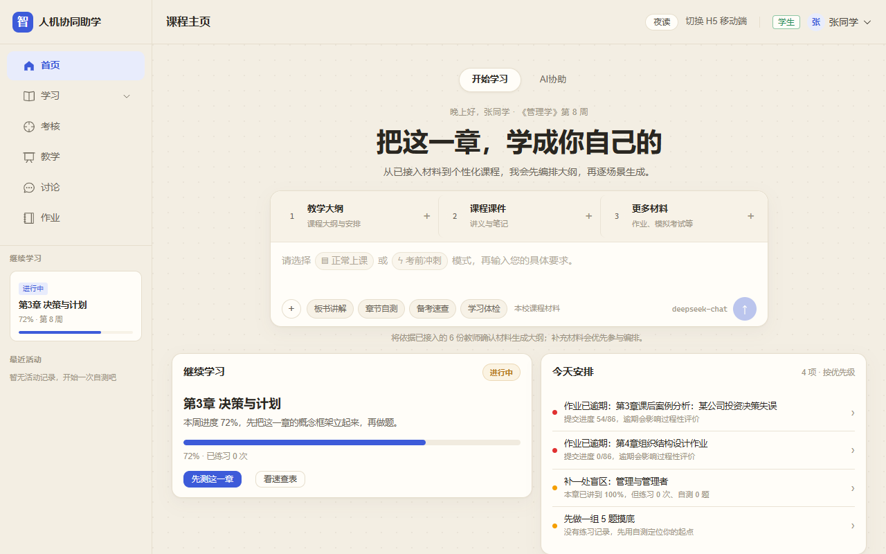
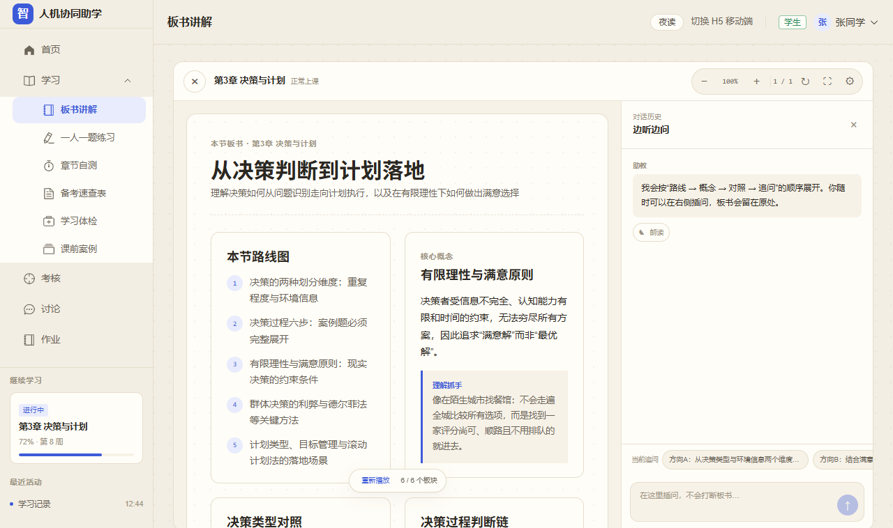

# 人机协同助学智能体

## 项目说明与功能报告

| 项目 | 内容 |
| --- | --- |
| 项目名称 | 人机协同助学智能体（经管智学） |
| 应用课程 | 北京化工大学经济管理学院《管理学》 |
| 参赛方向 | 2026 院级竞赛 · 智能体赛道 |
| 产品形态 | Vue 3 纯前端单页应用，Web 与 H5 双端，纸感/夜读双皮肤 |
| 核心定位 | 懂课程进度、懂学生盲区、能回到教师材料、可由教师治理的课程 AI 助教 |
| 当前版本 | `codex/handoff-hyperknow` 工作分支，已具备教学闭环、结构化板书和智能课程编排 |
| 报告日期 | 2026-11-04 |



---

## 一、执行摘要

本项目不是把通用聊天机器人放进课程页面，而是围绕一门真实经管课程，把“教师材料、课程进度、学生练习、盲区诊断、个性化反馈和教师审核”连接成一个可运行的学习闭环。

一句话概括：

> 学生打开系统就知道现在学什么、为什么学、下一步做什么；教师能看到全班的学习证据，并对 AI 生成的教学内容进行确认、修改和发布。

产品的四个核心原则是：

1. **资料第一**：回答和课程生成优先依据教师确认材料，材料未覆盖时明确说明，不编造页码、章节或观点。
2. **先测后讲**：通过章节自测、检索练习和板书内追问，让学生先暴露理解状态，再进入讲解与补强。
3. **教师治理**：AI 可以出题、编排课程和给反馈，但题目发布、案例选用、课程大纲和场景内容必须经过教师确认。
4. **可演示、可回退**：真实模型可用时调用 DeepSeek/OpenAI 兼容服务；断网、密钥失效或结构化输出失败时，自动使用教师确认稿生成确定性内容，并标记“演示缓存”。

项目的差异化不在于“接入了哪个大模型”，而在于把模型能力组织成了课程教学系统：教材有边界、学习有过程、反馈有证据、教师有控制权。

---

## 二、项目背景与问题定义

### 2.1 教学痛点

课程团队关注的不是单一“答疑效率”，而是大班教学中持续存在的五个问题：

| 痛点 | 具体表现 | 本项目的回应 |
| --- | --- | --- |
| 练习机会少 | 大班课堂难以让每位学生都获得表达和反馈机会 | “一人一题”：每位学生获得专属情境题与三维反馈 |
| 预习缺抓手 | 学生看完资料后仍不知道课堂要讨论什么 | 课前案例征集、AI 摘要与标签、教师选用课堂案例 |
| 考核方式单一 | 传统题目难以考查真实理解和知识迁移 | AI 模拟面试、逐人出题、口述式作答、教师最终评分 |
| 学生背景差异大 | 管理类、工科类学生需要不同的案例语境 | 将学科背景注入答疑、出题和案例情境 |
| 功能寻路成本高 | 学生知道“想练习”，但不知道应去哪个页面 | 统一输入框、本地意图规则、工具菜单和主动推荐 |

### 2.2 产品目标

本项目希望同时达成五个目标：

- **让学习连续**：从课前预习、课堂讲解、课后自测到考核反馈，不割裂成多个孤立工具。
- **让回答有依据**：课程材料进入检索上下文，AI 回答优先引用教师确认内容。
- **让反馈可行动**：不只告诉学生“对/错”，还给出证据、下一步练习和回查材料入口。
- **让 AI 不越权**：AI 负责生成与建议，教师负责确认、修改、发布和评分。
- **让演示稳定**：即使无网络、无模型或无后端，也能完整展示关键教学链路。

---

## 三、产品概览

### 3.1 面向角色

| 角色 | 主要目标 | 核心入口 |
| --- | --- | --- |
| 学生 | 看懂课程、完成练习、定位盲区、提交作业与考核 | 课程主页、板书、AI协助、自测、速查表、学习体检、案例、考核 |
| 教师 | 管理材料、查看学情、生成与复核考核、编排课程 | 教师主控台、资料库、课程编排、学情统计、考核、案例池 |
| 助教 | 协助教学管理和内容查看 | 与教师相近，但发布类操作保持只读 |
| 管理员 | 查看系统配置与全角色功能 | 全部页面与模型配置 |

演示账号为 `student`、`student2`、`ta`、`teacher`、`admin`，密码均为 `123456`。

### 3.2 双端与双皮肤

| 维度 | Web 端 | H5 移动端 |
| --- | --- | --- |
| 路由 | `/app/*` | `/m/*` |
| UI 框架 | Element Plus | Vant |
| 导航 | 侧栏分组、课程卡、最近活动 | 顶部导航、底部三栏 Tab |
| 设备策略 | 桌面/平板自适应；平板侧栏可收起 | 手机自动映射到 `/m`；也可手动切换 |
| 学习能力 | 完整教师治理、课程编排、板书、自测、考核 | 移动端核心学习链路与简化板书 |

视觉层提供两种浅色皮肤：

- **纸感 `yun`**：浅米色底、点阵纸纹、校园学习工作台气质，是默认皮肤。
- **夜读 `mo`**：浅色夜读纸、杂志排版、更安静的阅读氛围。

皮肤只改变语义令牌与组件表现，不改变业务逻辑；颜色、圆角、字体统一由 `tokens.css` 控制。

### 3.3 当前代码规模

| 指标 | 数量 |
| --- | ---: |
| `frontend/src` 源码文件 | 94 |
| Vue 页面 | 30 |
| Web 页面 | 16 |
| H5 页面 | 10 |
| Pinia Store | 14 |
| API 与提示词模块 | 13 |
| 工具模块 | 14 |
| 公共组件 | 5 |

---

## 四、系统架构

```text
公开落地页 / 登录 / 角色与设备守卫
                 │
        ┌────────┴────────┐
        │                 │
   Web 端 /app        H5 端 /m
        │                 │
        └────────┬────────┘
                 │
      课程学习与教师治理页面
                 │
   ┌─────────────┼──────────────┐
   │             │              │
本地规则层     AI 任务层       数据与知识层
意图/诊断/     DeepSeek 文本   localStorage
推荐/出题兜底   StepAudio 语音  IndexedDB
   │             │              │
   └─────────────┴──────────────┘
                 │
       教师确认稿 / 上传课件 / 学习记录
```

### 4.1 技术栈

| 层级 | 技术 |
| --- | --- |
| 前端框架 | Vue 3.5、Vite 8、Vue Router 5、Pinia 4 |
| Web UI | Element Plus 2.14 |
| H5 UI | Vant 4.10 |
| 图表 | ECharts 6 |
| 文件解析 | PDF.js、Mammoth、JSZip |
| 文本模型 | 默认 DeepSeek `deepseek-chat`，兼容任意 OpenAI 协议服务 |
| 语音模型 | 阶跃星辰 StepAudio 3 TTS |
| 本地数据 | `localStorage` + IndexedDB |
| 测试 | Playwright + Microsoft Edge |
| 部署 | Vite 构建 + `server.mjs` 深链接服务器 |

### 4.2 数据与模型链路

1. 教师通过首页材料卡或课程资料库接入材料。
2. 浏览器端提取正文，按约 420 字切片并写入 IndexedDB。
3. 答疑检索按“章节匹配 + 关键词命中”选取 Top-3 片段，最多约 2,000 字。
4. 课程编排使用更宽上下文，最多 6 个片段、约 6,000 字。
5. 模型只接收当前任务所需的材料片段，并返回受控文本或 JSON。
6. 前端执行结构校验、归一化和必要的一次修复。
7. 生成失败或模型不可用时，使用教师确认稿生成本地确定性结果。
8. 学习记录、练习、自测、案例和考核写入本地持久化层。

系统当前不使用向量数据库，也不做关键词检索对模型输出页码的伪造式补全；这类能力保留在后续页码级引用阶段。

---

## 五、核心页面与功能矩阵

| 页面 | 路由 | 主要功能 | 主要角色 |
| --- | --- | --- | --- |
| 产品落地页 | `/` | 项目介绍、痛点方案、工作方式、运行实况、FAQ、演示入口 | 公开 |
| 登录页 | `/login` | 角色快捷登录、Web/H5 入口、学科背景设置 | 公开 |
| 课程主页 | `/app/course` | 统一学习入口、材料上传、双学习模式、今日安排、章节进度、案例与研讨 | 全部 |
| 板书讲解 | `/app/board` | 结构化板书、逐块播放、右栏插问、语音教学、HTML 下载 | 全部 |
| AI协助 | `/app/ask` | 对话答疑、意图直达、每日推荐、材料依据、语音朗读 | 全部 |
| 一人一题 | `/app/practice` | 个性化情境题、作答、三维反馈、练习记录 | 全部 |
| 章节自测 | `/app/selftest` | 5/10/20 题、难度选择、自动判分、逐题解析 | 全部 |
| 备考速查表 | `/app/cheatsheet` | 主题化重组、来源标注、屏幕/打印版、复制与打印 | 全部 |
| 学习体检 | `/app/checkup` | 雷达图、三类盲区、证据、优先顺序、针对性练习 | 学生为主 |
| 课程资料库 | `/app/materials` | 材料增删改、切片统计、检索自检、恢复纲要 | 教师/助教/管理员 |
| 课前案例 | `/app/cases` | 学生投稿、AI 摘要标签、教师筛选、选用和驳回 | 学生/教师 |
| 课程考核 | `/app/assessment` | 圈人出题、逐题复核、发布、学生作答、教师评分 | 学生/教师 |
| 教师主控台 | `/app/console` | 课程概览、作业进度、学生预警、教学入口 | 教师/助教 |
| 学情统计 | `/app/statistics` | 教学趋势、章节掌握度、学生分层、分析结论 | 教师/助教 |
| 智能课程编排 | `/app/studio` | 两阶段建课、大纲审阅、逐场景生成、资源预览与导出 | 教师/助教 |
| 课程体验 | `/learn/:projectId` | 独立课程学习页、场景导航、生成进度与内容体验 | 登录用户 |
| 研讨论坛 | `/app/forum` | 搜索、章节筛选、置顶、发帖、角色标识 | 全部 |
| 作业管理 | `/app/homework` | 状态筛选、截止提醒、学生/教师双视角 | 全部 |
| 模型接入 | `/app/model` | 文本/语音配置、连接测试、人设与温度设置 | 教师/管理员 |

H5 端保留课程、板书、AI协助、一人一题、自测、速查表、学习体检、案例、考核、课程编排和“我的”等核心入口。

---

## 六、功能详解

### 6.1 公开落地页与角色入口

落地页承担“让评委和访客在 30 秒内理解项目”的任务，而不是只做装饰性封面。页面按“价值主张 → 五个痛点 → 四类角色 → 三步闭环 → 运行实况 → FAQ → 立即体验”展开。

功能包括：

- 展示课程背景、教学目标与产品定位；
- 用五个教学痛点对应五个模块，说明产品并非功能堆叠；
- 说明学生、教师、助教和管理员四类角色的完整动线；
- 展示 Web 与 H5、真实数据、材料依据、教师治理等能力；
- 提供匿名访客可直接进入的演示 CTA；
- FAQ 明确 AI 不直接代替学生作答、数据保存在哪里、如何切换模型等关键问题。

登录页支持角色标签快捷填入，并可选择进入 Web 端或 H5 端。学生可在“我的”中设置管理类、工科类或其他学科背景。

### 6.2 课程主页：统一学习编排器

课程主页是整个产品的“单入口”，把资料、学习意图、模式、课程进度与下一步推荐放在同一屏。

主要能力：

- **三类材料卡**：教学大纲、课程课件、更多材料，点击即可选择文件；
- **多文件导入**：支持 TXT、Markdown、CSV、JSON、HTML、PDF、DOCX、PPTX；
- **浏览器内解析**：PDF 保留页码标记，Word/PPT 提取正文，单文件最多保留 6 万字；
- **双学习模式**：正常上课强调跟随教学进度，考前冲刺强调高频考点、易错辨析和可答表达；
- **统一大输入框**：学生输入问题进入答疑；教师可输入课程目标，直接生成可编辑课程大纲；
- **`+` 学习工具菜单**：一步进入生成课程、板书讲解、AI协助、章节自测和学习体检；
- **继续学习**：显示当前章节、进度、练习次数与快捷操作；
- **今天安排**：根据作业截止、待答考核、盲区、练习间隔生成有理由的主动推荐；
- **章节掌握度**：用“未开始 / 已尝试 / 熟悉 / 熟练 / 已掌握”五级展示真实学习状态；
- **课堂案例联动**：教师选用案例后，学生课程主页自动置顶展示；
- **最近活动**：侧栏读取学习轨迹，帮助学生快速回到最近的练习或自测。

### 6.3 课程资料库与“资料第一”

课程资料库是 AI 回答与课程生成的共同依据。

核心能力：

- 内置《管理学》六章、40 个知识点的教师确认稿；
- 支持新增、编辑、删除和恢复课程纲要；
- 上传材料统一标记为“教师确认”；
- 自动切片并统计材料数、总字数、可检索片段数；
- 提供“检索自检”：教师可输入学生可能提出的问题，查看系统实际选中的材料片段；
- 答疑采用章节过滤、中文二字滑窗与英文词匹配，选取 Top-3；
- 没命中时优先回退本章前两片；仍无材料时要求模型明确回答“课程材料未涉及”；
- 课程编排可扩大为 Top-6、约 6,000 字的受控上下文。

这一层的价值不是“存文件”，而是让 AI 的回答具备可检查的课程边界。系统设计上坚持“模型只输出受控内容，来源和页码由前端数据回填”，避免模型自行编造引用。

### 6.4 AI协助：对话、意图直达与主动推荐

AI协助页将“自然语言问答”和“操作导航”结合，减少学生在功能之间寻找入口的成本。

能力包括：

- 支持多轮对话，携带最近 20 条消息作为上下文；
- 本地意图规则优先识别八类操作：待办、作业、练习、自测、速查表、学习体检、案例、考核；
- 命中操作意图时不调用模型，直接返回可点击行动卡；
- 未命中时再交给大模型自由答疑；
- 自动注入当前章节、正常上课/考前冲刺模式和学科背景；
- 回答优先使用课程材料，并显示“课程材料已接入”状态；
- AI 回答支持 StepAudio 3 语音朗读；
- “今天值得想一想”根据练习与画像每日生成推荐；
- 当学生要整段答案时，系统采用苏格拉底式提示：先给判断链或追问，不直接代替思考。

### 6.5 结构化板书：像老师讲解，而不是把 Markdown 刷白

板书页是本项目最重要的学习形态升级。AI 不生成自由画布或任意 HTML，而是填写受控的 block JSON，由前端统一渲染。

支持的六类 block：

| Block | 教学用途 |
| --- | --- |
| `outline` | 本节路线图，先建立知识骨架 |
| `definition` | 概念定义、适用条件与形象比喻 |
| `table` | 相近概念对照、维度比较 |
| `diagram` | 判断链、流程与关系图 |
| `callout` | 易错点、理解抓手和材料边界 |
| `question` | A/B 选择或开放追问 |



交互能力：

- 板书按“路线 → 概念 → 对照 → 追问”逐块出现；
- 支持暂停、继续、从头播放和板块进度显示；
- 支持 70%–140% 缩放、全屏、点阵背景开关；
- 右侧对话栏可随时插问，不打断板书主线；
- 当前 question block 的 A/B 选项点击后进入右栏对话；
- 讲解回复采用“先承接学生判断，再回到主线”的苏格拉底式反馈；
- 支持语音教学开关、5 种中文音色、语速控制、自动跟读字幕与下一段语音预取；
- 板书可下载为自包含 HTML，便于归档和课堂外查看；
- 模型失败时使用教师确认稿生成完整板书，并明确标注“演示缓存”。

H5 端提供简化板书与讨论抽屉，保留核心讲解、问答和播放控制。

### 6.6 一人一题：大班中的个性化练习

一人一题解决的是大班课堂“无法让每个人都开口”的问题。

功能流程：

1. 学生选择章节与题型；
2. 题型包括案例分析、情景模拟、即兴演讲；
3. AI 结合章节材料与学科背景生成专属题；
4. 学生用“课堂回答”的方式写下作答；
5. AI 从观点结构、理论运用、表达逻辑三个维度反馈；
6. 反馈先肯定有效思考，再给一条具体可执行改进；
7. 练习记录进入过程性评价，成为教师后续个性化出题的输入。

即使没有可用模型，系统也能生成确定性案例题和三维反馈，保证课堂演示不中断。

### 6.7 章节自测：先测后学

章节自测通过主动回忆暴露真实理解状态。

主要能力：

- 同时选择多个章节；
- 题量支持 5、10、20 题；
- 难度支持基础、中等、提高；
- 多章节按题量自动分配，每批最多 5 题，降低单次输出截断风险；
- 自动去重并按章节重新编号；
- 作答期间不显示对错和解析；
- 提交前提示未作答题数；
- 本地自动判分，记录正确率、耗时、错题和概念错误；
- 提交后逐题显示正确答案与解析；
- 可直接跳转到同章节速查表或学习体检；
- 记录用于更新掌握度、盲区和学习趋势。

### 6.8 备考速查表：按考试方式重组知识

速查表不是把课程纲要简单换排版，而是按“考试会怎么考”重新组织。

能力包括：

- 支持多章节组合；
- 生成前用两个澄清问题确认用途和关注题型；
- 可选择屏幕阅读版或打印压缩版；
- 按主题而非教材章节顺序重组；
- 每个知识点标注定义、考点、重点标记与来源章节；
- 支持浏览器打印/导出 PDF；
- 支持复制全文到笔记软件；
- 生成历史保存在本地；
- 无模型时根据教师确认稿生成确定性速查表。

### 6.9 学习者画像与学习体检

学习者画像由练习、自测、案例、考核和学科背景共同派生，不只记录“看过什么”。

画像包含：

- 六章学习掌握度；
- 五级掌握状态；
- 概念错误次数；
- 练习与自测次数；
- 活跃天数、正确率、最近学习时间；
- 案例兴趣标签；
- 薄弱章节与待处理盲区。

学习体检识别三类问题：

| 类型 | 判定 | 建议 |
| --- | --- | --- |
| 零覆盖 | 本章已开讲，但练习与自测均为 0 | 先做 5 题摸底 |
| 低表现 | 自测至少 3 题且正确率低于 60% | 回练同章重点，再做一组 |
| 概念盲点 | 同一概念累计答错至少 2 次 | 回到定义与考点，用自己的话复述 |

每条结论都带具体证据，并按“考核临近 × 薄弱程度”排序。页面还展示章节正确率雷达，并允许学生直接“针对这处练一组”或“看本章速查表”。

系统坚持没有数据就不生成看似完整的报告，而是引导学生先完成自测。

### 6.10 课前案例：学生投稿，教师选用

案例模块把学生从内容消费者变为课堂案例生产者。

学生端：

- 填写案例标题、相关章节、背景内容、参考链接和推荐理由；
- AI 辅助生成一句话摘要与知识标签；
- 查看个人投稿状态；
- 投稿计入过程性评价。

教师端：

- 浏览案例池；
- 按章节、状态、时间和章节顺序筛选排序；
- 查看摘要、标签、提交者与学科背景；
- 选用为“本节课案例”或驳回；
- 被选用的案例自动在课程主页置顶展示，并连接研讨论坛。

### 6.11 AI 课程考核：逐人出题与教师闭环

考核采用“模拟面试”思路，强调理解、表达和迁移，而不是只做选择题。

教师流程：

1. 按小组或学生名单圈选对象；
2. 选择考查章节、题型和难度；
3. AI 结合每位学生的过程性评价与学科背景逐人出题；
4. 教师查看参考要点；
5. 逐题编辑、通过、驳回或批量通过；
6. 至少一题通过后才能发布；
7. 学生作答并生成 AI 反馈；
8. 教师给出 0–100 最终评分。

学生流程：

- 只看到已发布且分配给自己的题目；
- 以“面向面试官口述”的方式作答；
- 获取参考要点与改进建议；
- 查看教师最终评分。

整个过程保留“AI 给反馈、教师做决定”的权限边界。

### 6.12 智能课程编排：两阶段、可控、可编辑

智能课程编排用于把教师材料转化为一节可体验的短课。

#### 第一阶段：生成可编辑大纲

教师输入章节、学习目标、学习者、目标时长和学习模式，系统检索教师材料并生成 3–10 个教学场景。

每个场景可编辑：

- 标题；
- 类型；
- 预计时长；
- 教学说明；
- 3–5 个要点；
- 对应材料来源。

支持调整顺序、添加或删除场景，并在生成前执行结构校验。目标时长支持 20、30、45 分钟。

#### 第二阶段：逐场景生成

确认后，系统以最多 3 路受控并发生成场景，每完成一幕立即写入 IndexedDB。

场景类型包括：

- **板书讲解**：概念、对照表、判断链和追问；
- **检索练习**：检查概念边界和常见误判；
- **案例应用**：给出现实管理情境、参考要点和评价量规；
- **收束复盘**：把本课压缩成判断链与下一步行动。

其他能力：

- 支持生成中断恢复和“当前场景完成后停止”；
- 已完成的场景可以立即体验，无需等待整门课完成；
- `/learn/:projectId` 提供独立课程体验页；
- 板书场景可进入完整板书学习页；
- 可下载单页板书 HTML；
- 可导出完整课程资源包 JSON；
- 最近课程持久保存，可重新编辑或删除；
- 模型结构不合格时自动修复一次，仍失败则使用确定性课程包。

### 6.13 教师主控台与学情统计

教师主控台提供教学管理总览：

- 选课人数、平均出勤、课堂互动、待批作业；
- 进行中作业的提交进度和截止时间；
- 需要关注的学生与预警原因；
- 智能课程编排、课程资料库和考核入口；
- 助教只读，教师/管理员可执行发布操作。

学情统计提供：

- 近六周出勤、互动与作业提交率趋势；
- 各章节班级掌握度雷达；
- 学生分层分布；
- 自动生成薄弱章节分析结论；
- 图表主题随皮肤切换重绘。

当前学情统计仍是仿真数据展示，接入后端后可直接替换为真实班级数据。

### 6.14 论坛、作业与模型设置

**研讨论坛**支持关键词搜索、章节筛选、置顶帖优先、发帖弹窗、已解决状态和角色标识。当前发帖为仿真交互，刷新后不保留。

**作业管理**支持学生/教师双视角、状态筛选、截止倒计时、提交进度、成绩查看和批改入口。当前提交与批改为演示交互，等待后端落库。

**模型接入**支持：

- DeepSeek、阶跃星辰和自定义 OpenAI 兼容服务；
- 文本模型、接口地址、密钥、温度和助教人设；
- StepAudio 语音接口、模型、音色、语速和朗读指导；
- 文本连接测试与语音试听；
- 一键恢复默认配置。

---

## 七、典型使用动线

### 7.1 学生：从“我想学这一章”到“知道下一步”

```text
登录
  → 选择正常上课/考前冲刺
  → 在首页提问或上传材料
  → 进入板书讲解，边听边问
  → 完成章节自测
  → 查看学习体检与盲区证据
  → 针对盲区再练一组
  → 生成考前速查表
  → 完成教师发布的模拟面试考核
```

这条动线形成了“输入目标 → 学习 → 检索练习 → 诊断 → 补强 → 输出材料 → 考核”的完整循环。

### 7.2 教师：从材料到可发布教学任务

```text
登录教师账号
  → 首页上传大纲/课件
  → 课程资料库确认识别结果
  → 从首页输入目标或在课程编排页生成大纲
  → 审阅场景并调整要点/顺序
  → 逐场景生成课程资源
  → 在考核页圈人出题
  → 复核题目
  → 发布给学生
  → 查看作答、反馈与最终评分
```

### 7.3 8 分钟竞赛演示建议

1. **产品落地页（30 秒）**：一句话定位、五类痛点和教师治理特色。
2. **首页（60 秒）**：三类材料卡、双模式、大输入框、今日安排。
3. **材料接入（45 秒）**：上传 PDF/PPT，展示正文提取与检索自检。
4. **结构化板书（120 秒）**：逐块讲解、右栏插问、A/B 追问、语音与下载。
5. **自测与学习体检（90 秒）**：完成 5 题，查看正确率、盲区和下一步。
6. **一人一题（45 秒）**：生成专属题，展示三维反馈。
7. **教师考核闭环（75 秒）**：圈人出题、复核、发布、学生视角。
8. **智能课程编排（60 秒）**：从材料生成大纲，再进入逐场景课程体验。
9. **总结（30 秒）**：资料第一、教师治理、可回退、双端可用。

---

## 八、项目特色与创新点

### 8.1 从“课程问答”升级为“全周期教学闭环”

多数教育 AI 停留在单轮问答。本项目把课前案例、课堂讲解、课后自测、速查表、学习体检、过程性评价和课程考核连接起来，使每次交互都能成为下一次教学决策的依据。

### 8.2 资料第一，而不是模型第一

系统内置教师确认稿，并支持教师导入自己的材料。AI 只能在选定的材料片段内组织回答，材料不足时明确说明。与“只给模型一句课程名字”相比，这种方式更接近真实课程场景。

### 8.3 结构化板书，而非自由画布

AI 只填写受控 block，前端统一渲染标题、定义、表格、判断链、提示卡和追问。这样做带来四个好处：

- 内容稳定，可做结构校验；
- 视觉一致，不会每次生成不可控布局；
- 可以逐块播放、导出 HTML 和离线兜底；
- 不会把课程页面变成不可审计的自由生成画布。

### 8.4 苏格拉底式引导，而不是直接代答

答疑、练习反馈和板书追问都强调先提问、先给判断链、先让学生表达。系统的目标是提升学生的思考和表达能力，而不是提供一键标准答案。

### 8.5 同一章节，不同学生得到不同练习

学科背景、练习记录和薄弱概念进入生成任务，使管理类学生得到企业管理情境，工科类学生得到工程管理、生产现场和项目协作情境。

### 8.6 每条推荐都解释“为什么是它”

今日安排不是静态待办卡，而是由作业截止、待答考核、最高风险盲区、练习间隔和学习体检数据共同排序。每条推荐都能说明触发原因并直达行动。

### 8.7 教师真正处于回路中

案例需要教师选用，考核需要教师复核发布，课程大纲需要教师确认，课程场景由教师审阅，最终评分由教师完成。AI 提高效率，但不替代教学判断。

### 8.8 两阶段课程生成降低“AI 一键建课”的失控风险

先只生成可编辑大纲，再逐场景生成内容；场景完成即保存、可停止、可恢复、可预览、可导出。它比“一句话直接生成整门课”更符合教师工作方式，也更容易质量控制。

### 8.9 确定性兜底让课堂演示可重复

关键 AI 功能都具备本地兜底：

- 答疑意图规则；
- 一人一题题目与反馈；
- 自测题库；
- 速查表；
- 学习诊断；
- 结构化板书；
- 课程大纲与场景内容。

模型故障时，页面标明“演示缓存”，既不假装真实生成，也不中断学习。

### 8.10 双端一致，但不机械复制

Web 端重点服务教师治理、复杂内容和课程编排；H5 端重点服务学生随时学习。两棵树共享状态、数据和视觉令牌，同时为不同屏幕优化导航与信息密度。

---

## 九、工程与可靠性设计

### 9.1 路由与权限

- `/app/*` 与 `/m/*` 分开承载 Web/H5；
- 设备守卫根据屏幕和手动选择在两端映射；
- 新增 Web/H5 页面必须同步映射，避免手机被送回首页；
- `meta.roles` 控制教师、助教和管理员页面权限；
- 未登录跳登录页，角色不符跳 403；
- 旧路径自动重定向到 `/app/*`，保留查询参数与锚点。

### 9.2 模型调用的稳健性

- 统一 OpenAI 兼容调用；
- 请求超时、429/5xx 重试与友好错误映射；
- 文本任务和 JSON 任务分层；
- JSON 解析支持宽松回退与一次结构修复；
- 每次任务记录模型、耗时、输入/输出哈希、关联材料与失败状态；
- 任务型提示词集中管理，便于版本化。

### 9.3 语音合成

- 非流式 StepAudio 3 TTS；
- 单次文本最多 1,000 字；
- 最多缓存 16 条音频；
- 当前段落播放时预取下一段；
- 同一时间只播放一条朗读；
- 浏览器禁止自动播放时显示提示，但字幕和板书播放继续。

### 9.4 本地存储

- `localStorage`：登录态、模型配置、皮肤、设备偏好、练习、自测、案例、考核、上传历史；
- IndexedDB：知识材料、课程编排项目；
- 存储不可用时静默降级为当前会话内存，不阻塞主流程；
- 上传文件只在浏览器内解析，演示数据不依赖服务端。

### 9.5 构建与部署

- 常规构建：`npm run build` → 多文件 `dist/`；
- 离线构建：`npm run build:offline` → 单文件 `dist-offline/index.html`；
- `base: './'` 支持相对路径与 `file://` 演示；
- 生产深链接使用 `server.mjs` 改写资源路径并执行 SPA 回退；
- 直接访问 `/app/board`、`/m/board`、`/learn/:projectId` 刷新不应白屏。

---

## 十、验证结果与当前状态

### 10.1 本轮实测

2026-11-04 在本工作区完成：

| 检查 | 结果 |
| --- | --- |
| `npm run build` | 通过，2636 个模块完成构建 |
| `npm run test:e2e` | 18/18 通过，21.4 秒 |
| 生产服务器深链接 | 已纳入 E2E，`/app/board` 刷新通过 |
| H5 板书讨论 | 已纳入 E2E |
| 首页文件导入 | TXT/Markdown 与 PDF 已纳入 E2E |
| 无模型兜底 | 一人一题、自测、速查表均通过 E2E |
| 教师考核闭环 | 生成、复核、发布通过 E2E |
| 皮肤持久化 | 刷新后保持通过 E2E |
| 课程编排 | 两阶段生成与 H5 映射通过 E2E |
| 板书下载与语音设置 | 通过 E2E |

构建仍有大体积 chunk 告警：Element Plus/ECharts 主包超过 500KB，PDF worker 约 1.27MB。这是既有工程优化项，不影响当前功能运行。

### 10.2 真实模型证据

项目已有发布证据记录：

- DeepSeek 普通回答；
- StepAudio 3 TTS；
- 板书语音跟随字幕自动播报；
- DeepSeek 结构化板书；
- DeepSeek 课程大纲与首个场景；
- 真实首页建课实测：7.9 秒生成大纲，17.6 秒完成 6 个场景。

对应证据见 [EVIDENCE-2026-11-04-deepseek-course.md](docs/release/EVIDENCE-2026-11-04-deepseek-course.md)。

### 10.3 当前成熟度判断

| 能力域 | 状态 |
| --- | --- |
| 学生核心学习闭环 | 已完成并可演示 |
| 教师资料与学情治理 | 已完成核心链路 |
| 一人一题与自测 | 已完成，含确定性兜底 |
| 结构化板书与追问 | 已完成核心垂直切片 |
| 课程编排与课程体验 | 已完成可编辑、可恢复的两阶段流程 |
| 双端与双皮肤 | 已完成 |
| E2E 关键链路 | 已重建并通过 18 条确定性用例 |
| 后端真实业务落库 | 未完成 |
| 页码级引用 | 未完成 |
| 公网部署同步 | 需按部署权限另行发布 |

---

## 十一、已知边界与风险

### 11.1 演示系统边界

- 当前为纯前端项目，没有正式后端、统一身份认证和数据库；
- 论坛发帖、作业提交、批改等仍为仿真交互，刷新后不保留；
- 学情统计页使用仿真班级数据；
- 教师主控台部分操作是演示入口；
- 学生、课程、班级和成绩均为仿真数据，不包含真实个人信息。

### 11.2 AI 能力边界

- 页码级引用尚未接入，当前主要提供章节、材料标题和片段来源；
- 扫描版 PDF 没有 OCR，复杂版式 PPTX 的提取质量需要继续验收；
- 旧版 `.doc`、`.ppt` 不支持，需另存为 `.docx`、`.pptx`；
- 真实模型的结构化输出虽有一次修复，但仍需长期抽测稳定性；
- 板书和课程生成失败时使用教师确认稿兜底，不等同于真实模型生成。

### 11.3 发布前必须处理

**API 密钥风险：** 当前比赛演示阶段，前端配置中存在临时内置文本与语音密钥。正式公开部署前必须：

1. 轮换所有已暴露密钥；
2. 移除源码中的明文密钥；
3. 将模型调用迁移到后端代理；
4. 清理 Git 历史中的历史密钥；
5. 重新执行构建、真实模型测试和安全检查。

### 11.4 工程优化项

- Element Plus、ECharts 与 PDF worker 体积较大，可做按需引入和更细粒度分包；
- 统计页需要从仿真数据切换到学习者画像与真实班级数据；
- 论坛、作业和班级数据需要后端仓储层；
- 学习计划 `studyPlan` 仍未实现；
- 板书“自动跟随当前 block”的平移/滚动可继续增强；
- 更完整的黄金题库抽测与正式发布证据仍需持续更新。

---

## 十二、后续路线

| 优先级 | 方向 | 目标 |
| --- | --- | --- |
| P0 | 密钥迁移与轮换 | 将模型密钥移到后端，消除公开构建泄露风险 |
| P0 | 后端接口落地 | 登录、课程、材料、练习、考核、论坛、作业正式持久化 |
| P0 | 真实数据学情统计 | 用画像、练习和考核数据替换仿真图表 |
| P1 | 页码级引用 | 模型只返回 `chunkId`，前端回填材料、章节、页码 |
| P1 | 学习计划 | 生成 7 日计划，与今日 Feed、自测和体检联动 |
| P1 | 板书跟随与笔记 | 自动跟随当前 block，增加个人笔记与复看定位 |
| P1 | 真实课堂验收 | 黄金题库多轮抽测，形成可追溯发布报告 |
| P2 | 包体与性能 | UI 库按需引入，减少首屏资源 |
| P2 | 学科扩展 | 以管理学为标杆，扩展到统计学及其他经管课程 |

---

## 十三、结论

本项目的核心价值，是把“大模型能回答”转化为“课程能持续运行”：

- 学生获得随时可用的讲解、练习、诊断与反馈；
- 教师获得可确认的材料、可复核的题目、可编辑的课程和可解释的学情；
- AI 始终处于“助教”位置，不替代教师判断，也不替代学生思考；
- 模型不可用时仍有确定性内容托底，保证演示与学习闭环连续。

从产品形态看，项目借鉴了优秀学习产品的“资料第一、单入口、白板讲解、先测后讲、主动推荐”范式，但保留了自己的课程治理、教师审核、教材依据和可审计特色。它不是课程集市，也不是一句话生成整门课的工具，而是一套嵌入真实课程全教学周期的人机协同助学系统。

---

## 附录 A：演示账号

| 账号 | 姓名 | 角色 | 说明 |
| --- | --- | --- | --- |
| `student` | 张同学 | 学生 | 管理类背景 |
| `student2` | 李骁 | 学生 | 工科类背景 |
| `ta` | 李助教 | 助教 | 教学相关页面，发布操作只读 |
| `teacher` | 王教授 | 教师 | 完整教学治理 |
| `admin` | 系统管理员 | 管理员 | 全部页面 |

统一密码：`123456`

## 附录 B：常用命令

```bash
cd frontend
npm install
npm run dev
npm run build
npm run build:offline
npm run test:e2e
npm run test:e2e:live
npm start
```

- 开发地址：`http://localhost:5173`
- 生产预览：`http://localhost:4173`
- 离线演示：构建后直接打开 `dist-offline/index.html`

## 附录 C：主要证据与文件

- 交接与总体说明：[Codex交接文档.md](Codex交接文档.md)
- HyperKnow 逐帧复评：[docs/research/hyperknow-frame-review.md](docs/research/hyperknow-frame-review.md)
- OpenMAIC 适配说明：[docs/research/openmaic-project-review.md](docs/research/openmaic-project-review.md)
- 黄金题库：[docs/qa/golden-set.md](docs/qa/golden-set.md)
- DeepSeek 与课程生成证据：[docs/release/EVIDENCE-2026-11-04-deepseek-course.md](docs/release/EVIDENCE-2026-11-04-deepseek-course.md)
- 关键链路 E2E：[frontend/tests/e2e/critical-flows.spec.js](frontend/tests/e2e/critical-flows.spec.js)
- 真实模型 E2E：[frontend/tests/e2e/live-stepfun.spec.js](frontend/tests/e2e/live-stepfun.spec.js)
- 第三方声明：[THIRD_PARTY_NOTICES.md](THIRD_PARTY_NOTICES.md)

